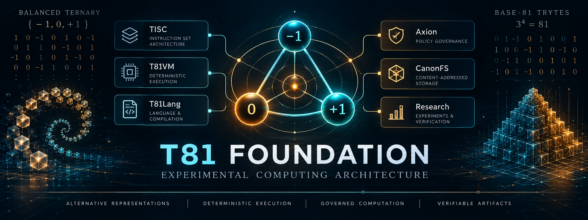
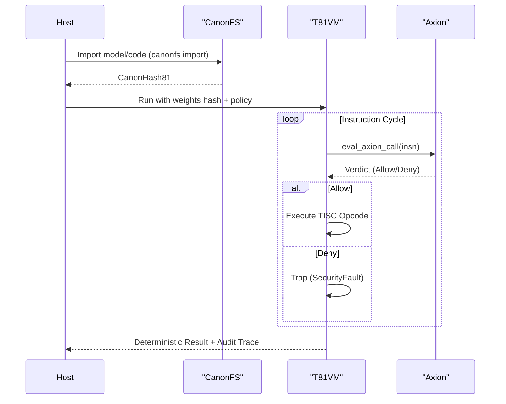

# T81 Foundation — Governed Runtime for Immutable, Deterministic Execution

<p align="center">
  
</p>

**Immutable, hash-verified artifacts • Pre-side-effect policy enforcement • Bit-exact reproducibility • Ternary-native execution**

[English](./README.md) | [简体中文](./README.zh-CN.md) | [Español](./README.es.md) | [Русский](./README.ru.md) | [Português](./README.pt-BR.md)


[](https://deepwiki.com/t81dev/t81-foundation)

## What is T81

T81 is a deterministic, policy-gated runtime substrate for producing **canonical decision objects with identity** from governed computation and AI tasks.

Instead of consuming unverified model outputs or unmonitored side effects, T81 produces **durable decision bundles** that carry complete cryptographic provenance, bit-exact replayability, and cross-system portability.

Policies are evaluated deterministically and enforced by the **Axion** governance kernel before execution or materialization occurs. Governance does not rely on runtime heuristics, anomaly scoring, or after-the-fact log parsing. T81 can be adopted incrementally via **CanonFS** content-addressed storage and policy enforcement without requiring full stack adoption.

## Why This Matters

- **Decision objects over interpretation** — AI decisions become verifiable, consumable artifacts with durable identity.
- **Pre-side-effect policy enforcement** — Axion validates execution rules before state changes or storage side effects occur.
- **Immutable provenance** — Every artifact, input, and state change is content-addressed in CanonFS with verifiable lineage.
- **Bit-exact replayability** — Identical inputs and seeds produce bit-identical execution traces and output hashes across platforms.
- **Cross-system portability** — Decision bundles can be verified and consumed without depending on the original execution environment.

## When to Use T81

- **When you need verifiable decision objects** rather than raw, unverified model text or unmonitored execution.
- **When execution must be policy-gated before side effects** occur in storage, network, or host systems.
- **When complete cryptographic provenance** is required for compliance, regulatory audit, or supply-chain security.
- **When deterministic replayability** across heterogeneous execution environments is a mandatory security contract.

## Real-World Use Cases

- **Governed AI decision chains** — Produce policy-approved, verifiable decision bundles from bounded AI tasks (`assess-fixed`, `route-fixed`, `classify-fixed`).
- **Security governance & access control** — Enforce fail-closed pre-execution policy checks on sensitive data imports and exports.
- **Compliance & regulatory auditing** — Maintain content-addressed archives of decision artifacts and execution traces for independent verification.
- **Release gates & deployment authorization** — Use canonical decision bundles as cryptographic approval evidence for deployment pipelines.
- **Cross-environment handoff** — Transfer verifiable decision bundles between distinct systems without losing execution context or provenance.

## System Guarantees

- **Cryptographic identity** — Content-addressed bundles (CanonHash-81) provide tamper-evident proof of decision integrity.
- **Deterministic replay** — Identical inputs produce bit-identical decision objects across supported platform architectures.
- **Fail-closed policy enforcement** — All operations are validated against governance rules before side effects occur.
- **Immutable storage** — CanonFS guarantees content immutability and complete auditability.
- **Cross-system portability** — Bundles are self-contained and consumable without host runtime dependencies.

## Architectural Pillars

1. **Canonical Decision Objects** — Content-addressed **bundles** providing verifiable artifacts with complete execution provenance.
2. **Policy Enforcement (Axion)** — Fail-closed governance kernel validating decisions before state changes or materialization.
3. **Immutable Storage (CanonFS)** — Content-addressed, hash-verified storage backend for decision chains and evidence.
4. **Deterministic VM (T81VM / TISC ISA)** — Bit-exact execution engine running the frozen TISC instruction set architecture (v1.9.0).

## Best Current Surfaces

For the clearest, most actionable entry points in the repository today:

- **T81 Operator Guide**: [docs/explanation/T81_OPERATOR_GUIDE.md](docs/explanation/T81_OPERATOR_GUIDE.md) — The practical guide for operating core T81 surfaces.
- **CanonFS Interchange Contract (RFC-00D1)**: [spec/rfcs/RFC-00D1-canonfs-foreign-filesystem-interchange.md](spec/rfcs/RFC-00D1-canonfs-foreign-filesystem-interchange.md) — Import/export interchange specification.
- **Bounded AI OS-Object Family Status**: [docs/status/BOUNDED_AI_OS_OBJECT_FAMILY_STATUS.md](docs/status/BOUNDED_AI_OS_OBJECT_FAMILY_STATUS.md) — Admitted decision chain family (`assess-fixed`, `route-fixed`, `classify-fixed`).
- **Bundle Consumption Contract**: [docs/reference/AI_OS_OBJECT_BUNDLE_CONSUMPTION_CONTRACT.md](docs/reference/AI_OS_OBJECT_BUNDLE_CONSUMPTION_CONTRACT.md) — Contract for external consumers of decision bundles.

## Core Subsystems & Maturity

| Subsystem | Role | Maturity |
| :--- | :--- | :--- |
| **TISC ISA** | Frozen ternary instruction set architecture (v1.9.0) | **Frozen** |
| **T81VM** | Deterministic interpreter with Axion policy hooks | **Stable** |
| **Axion Kernel** | Governance kernel enforcing pre-side-effect policies | **Stable** |
| **CanonFS** | Immutable, content-addressed storage backend | **Stable** |
| **T81Lang** | High-level language frontend for ternary logic | **Stable** |

The **Deterministic Core Profile (DCP)** (TISC ISA, core VM, and data types) forms the verified deterministic surface. Experimental research areas (e.g., Cognitive Tiers, Hanoi VM) sit outside the DCP in the experimental frontier.

## Execution Workflow

T81 ties immutable inputs to deterministic outcomes through a policy-gated pipeline:



## Quick Start

### 1. 30-Second Proof: CanonFS + Axion Policy Gating

This proof demonstrates content-addressed artifact storage and pre-side-effect policy enforcement.

```bash
tmp_root="$(mktemp -d)"
canon_root="$tmp_root/.t81_canonfs"

# 1. Import an artifact into CanonFS
./build/t81 canonfs import \
  examples/storage-and-canonfs/canonfs-interchange/v1/model.t81w \
  --canonfs-root "$canon_root" \
  --json

# Extract imported CanonHash81 hash
canon_hash=$(./build/t81 canonfs import \
  examples/storage-and-canonfs/canonfs-interchange/v1/model.t81w \
  --canonfs-root "$canon_root" \
  --json | grep -o '"hash": "[^"]*"' | head -n 1 | cut -d'"' -f4)

# 2. Export the artifact back by CanonHash81 reference
./build/t81 canonfs export \
  "$canon_hash" \
  --canonfs-root "$canon_root" \
  --out "$tmp_root/restored.t81w" \
  --json

# 3. Attempt import under a denying Axion policy
./build/t81 canonfs import \
  examples/storage-and-canonfs/canonfs-interchange/v1/model.t81w \
  --canonfs-root "$canon_root" \
  --policy examples/storage-and-canonfs/canonfs-interchange/v1/policy-deny-all.apl \
  --json
```

**Expected results:**
- Steps 1 and 2 return `status: "ok"`.
- Step 3 returns `status: "error"` with `kind: "policy-failure"` and `reason: "policy_denied"`, blocking side effects prior to storage write.

### 2. Docker One-Liner (~60 seconds)

```bash
docker run --rm -it ghcr.io/t81dev/t81-foundation demo
```

Executes hello-world → ternary demo → determinism verification → interactive REPL.

### 3. Native Build (Linux/macOS)

```bash
git clone https://github.com/t81dev/t81-foundation.git
cd t81-foundation
cmake -B build -G Ninja -DCMAKE_BUILD_TYPE=Release
cmake --build build
ctest --test-dir build --output-on-failure
```

Key CMake configuration options:
- `T81_STRICT_DETERMINISTIC_FLOAT=ON` (default) — Enforces bit-exact float calculation paths.
- `T81_BUILD_EXAMPLES=ON` (default) — Builds checked-in C++ demonstration binaries.

### 4. Admitted Bounded AI OS-Object Family Examples

Run the admitted decision chain compositions:

```bash
# 1. Host action decision chain
bash examples/ai-and-inference/model-load-canonfs/run_assess_fixed_host_action.sh

# 2. Path selection decision chain
bash examples/ai-and-inference/model-load-canonfs/run_route_fixed_path_selection.sh

# 3. Rule selection decision chain
bash examples/ai-and-inference/model-load-canonfs/run_classify_fixed_rule_selection.sh
```

Each script outputs a content-addressed decision bundle (`.json`) containing:
- AI task result artifact
- Execution provenance artifact
- Typed downstream record
- Canonical bundle header

To inspect or summarize a generated decision bundle:

```bash
bash examples/ai-and-inference/model-load-canonfs/summarize_ai_bundle.sh <bundle_ref> <canonfs_root>
```

## What T81 is Not (Yet)

- **Not a general-purpose OS** — T81 is a governed execution runtime, not a desktop/server OS replacement.
- **Not a drop-in binary host** — T81 executes TISC bytecode and governed T81Lang programs, not arbitrary host binaries.
- **Not dependent on physical ternary hardware** — Balanced ternary logic and Base-81 encodings run deterministically on conventional binary CPUs (x86_64, ARM64) via SWAR vectorization.
- **Not an unconstrained AI inference engine** — T81 prioritizes decision integrity, provenance, and policy enforcement over maximum throughput.

## Project Status & Governance

As of 2026, the T81 deterministic core (TISC ISA v1.9.0, core VM, and data types) is frozen and governed under the **Deterministic Core Profile (DCP)**.

- **Determinism boundaries** are defined by the [Deterministic Core Profile](docs/status/SYSTEM_STATUS.md) and tracked in the [Determinism Surface Registry](docs/governance/DETERMINISM_SURFACE_REGISTRY.md).
- Detailed project dashboards, active risk registers, and decision logs are available in [`docs/status/`](docs/status/).

## Long-Term Direction

T81 is evolving toward an environment where decision objects and reasoning paths are treated as first-class governed software artifacts: provenance-bound, policy-mediated, and executable within defined cognitive tiers.

The long-term objective is a computing environment where cognitive processes can be stored, invoked, composed, and governed with the same rigor applied to systems code, processes, and files.

## License

Licensed under the [Apache License, Version 2.0](LICENSE).

---

For contribution guidelines and development rituals, see [CONTRIBUTING.md](CONTRIBUTING.md) and [AGENTS.md](AGENTS.md).
