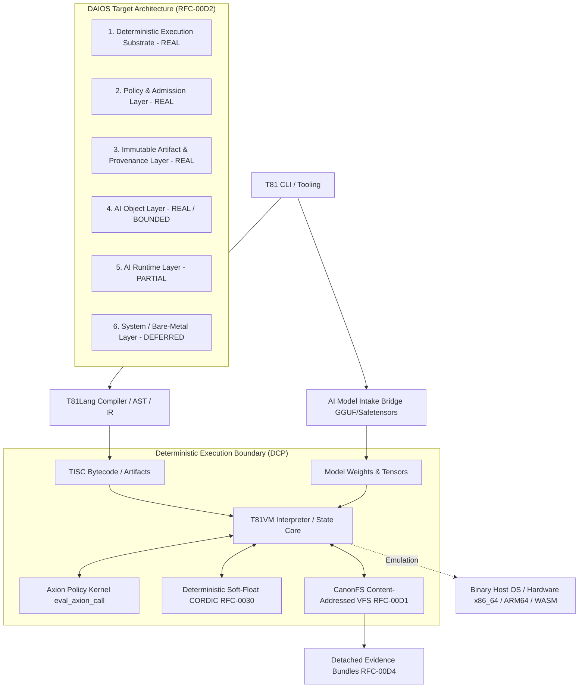

# T81 Research Continuity — SYSTEM_ARCHITECTURE

**Document ID:** `docs/ai-context/SYSTEM_ARCHITECTURE.md`
**Version:** 1.0.0 · **Last Reviewed:** 2026-10-29
**Source Baseline Commit:** `f6d4d680709c5c6c98b305628e04346f5ef61620`
**Status:** Authoritative System Architecture & Subsystem Specification

---

## 1. Subsystem Architecture Map

The T81 architecture organizes execution into explicit, policy-governed layers designed to decouple higher-level AI workflows from host hardware while maintaining bit-exact determinism.

---

## 2. Core Subsystems and Responsibilities

### 2.1 TISC Instruction Set Architecture (v1.9.0)
- **Path:** `include/t81/isa/opcodes.hpp`, `src/isa/`
- **Role:** Frozen 81-opcode instruction set operating on a 64-bit virtual register state machine (`STATE = (R, PC, SP, FLAGS, MEM, META)`).
- **Maturity:** **FROZEN (v1.9.0)**. Opcode values and state encoding are protected against casual modification.
- **Key Opcode Domains:** Arithmetic, logic, flow control, CanonFS I/O, Axion policy calls, and tensor descriptors.

### 2.2 T81VM Virtual Machine Core
- **Path:** `src/vm/vm.cpp`, `include/t81/vm/vm.hpp`
- **Role:** Deterministic Core Profile (DCP) execution engine. Decodes TISC bytecode, manages VM memory frames, and enforces pre-dispatch policy checks (`eval_axion_call`).
- **Maturity:** **BETA RUNTIME**. Delivers cross-platform bit-exact execution parity across x86_64, ARM64, and WebAssembly targets.

### 2.3 Axion Policy Governance Engine
- **Path:** `src/axion/`, `include/t81/kernel/axion/`
- **Role:** Pre-side-effect access control kernel. Evaluates authorization rules prior to state mutations, filesystem I/O, or external FFI dispatches.
- **Maturity:** **ALPHA GOVERNANCE**. Fails closed; logs explicit rejection reasons in `vm->state().axion_log` on denial.

### 2.4 CanonFS Content-Addressed Identity File System
- **Path:** `src/core/fs/`, `include/t81/fs/`
- **Role:** Content-addressed VFS implementing cryptographic hash verification (CanonHash-81) and foreign file system interchange ([RFC-00D1](../../spec/rfcs/RFC-00D1-canonfs-foreign-filesystem-interchange.md)).
- **Maturity:** **BETA IDENTITY FS**. Provides immutable artifact storage, provenance manifests, and export/import contracts (`t81.canonfs-import.v1`, `t81.canonfs-export.v1`).

### 2.5 T81Lang Tooling & Compiler
- **Path:** `src/lang/`, `include/t81/lang/`
- **Role:** High-level source lexer, parser, AST builder, IR generator, and TISC bytecode compiler.
- **Maturity:** **BETA LANGUAGE**. Supports structured control flow, domain assertions, and TISC compilation.

### 2.6 Deterministic Soft-Float Subsystem (RFC-0030)
- **Path:** `src/core/isa/math/`, `vm/determinism/`
- **Role:** Software implementation of transcendental math functions (sin, cos, exp, log, CORDIC) to eliminate platform-dependent `libm` floating-point rounding discrepancies.
- **Maturity:** **FUNCTIONAL / DCP**. Essential for bit-exact cross-platform neural network trace replay.

### 2.7 AI Model Intake & Tensor Bridge
- **Path:** `src/tools/model/`, `tools/cli/ai/`
- **Role:** Metadata bridge for inspecting GGUF and Safetensors model headers, inventorying weight tensors, and packing 2-bit tryte weights (`.t81w`).
- **Maturity:** **METADATA BRIDGE**. Inspects tensor geometry and converts weights; CPU execution uses SWAR emulation.

---

## 3. DAIOS Target Architecture & Layering (RFC-00D2)

The Deterministic Artificial Intelligence Operating System ([RFC-00D2](../../spec/rfcs/RFC-00D2-daios-target-architecture-and-sequencing.md)) establishes a 6-layer architecture map. This map governs planning discipline: **design ahead, implement behind proof**.

| Layer ID | Layer Name | Material Implementation Reality | Current Build-Against Scope |
| :--- | :--- | :--- | :--- |
| **Layer 1** | **Deterministic Substrate** | **REAL** | T81VM, DCP determinism, soft-float math (RFC-0030), cross-platform CTest suites. |
| **Layer 2** | **Policy & Admission** | **REAL** | Axion pre-side-effect evaluation, fail-closed policy checks, audit logging. |
| **Layer 3** | **Immutable Artifacts** | **REAL** | CanonFS content-addressed storage, provenance manifests (RFC-00D1). |
| **Layer 4** | **AI Object Layer** | **REAL / BOUNDED** | Bounded family (`assess-fixed`, `route-fixed`, `classify-fixed`). |
| **Layer 5** | **AI Runtime Layer** | **PARTIAL** | Model intake bridge, Safetensors header parsing, deterministic trace cache. |
| **Layer 6** | **System / Bare-Metal** | **DEFERRED** | Bare-metal kernel / TernaryOS deferred until Layers 1–4 are fully stabilized. |

---

## 4. Implementation Maturity Matrix

| Component / Subsystem | Source Path | Target RFC / Spec | Test Verification Target | Maturity Level |
| :--- | :--- | :--- | :--- | :--- |
| **TISC ISA Core** | `src/isa/` | `spec/tisc-spec.md` | CTest #391–396 | **Frozen (v1.9.0)** |
| **T81VM DCP Engine** | `src/vm/` | `spec/vmspec.md` | `vm_determinism_property_test` | **Beta Runtime** |
| **Axion Policy Engine** | `src/axion/` | `spec/rfcs/RFC-00D2-daios-target-architecture-and-sequencing.md` | CTest #154 | **Alpha Governance** |
| **CanonFS Interchange** | `src/core/fs/` | `spec/rfcs/RFC-00D1-canonfs-foreign-filesystem-interchange.md` | CTest #84–85 | **Beta Identity FS** |
| **Soft-Float CORDIC** | `src/core/isa/math/` | `spec/rfcs/RFC-0030-deterministic-math-subsystem.md` | CTest #355 | **Functional / DCP** |
| **Accountable Evidence** | `examples/governance/` | `spec/rfcs/RFC-00D4-accountable-decision-bundle.md` | CTest #4 | **Research Reference** |
| **Ternary Hardware RTL** | `rtl/core/` | `t81-hardware` repo | Verilog / SystemVerilog simulation | **Experimental / RTL** |
| **2-Bit MatVec SIMD** | `experiments/` | `PACKED_TERNARY_MATVEC_PERFORMANCE_REPORT.md` | `t81_packed_ternary_matvec` | **Experimental / Frozen** |

---

## 5. Architectural Limitations & Integration Gaps

1. **Software CPU Emulation Tax:** Binary vector ALUs (AVX2/NEON) incur heavy bit-shuffle overhead when unpacking 2-bit tryte fields during MatVec execution, limiting performance to $75.3\%$ of INT8 AVX2.
2. **Durable Witness Isolation:** As demonstrated in `experiments/durable_witness/`, an isolated SQLite WAL witness store remains vulnerable to snapshot rollback unless paired with external monotonic sequence counters or append-only HMAC receipt ledgers.
3. **Draft Interchange Boundaries:** While RFC-00D1 v1 JSON seed contracts are stable enough for tooling, full foreign filesystem interop, symlink postures, and archive bundle exports remain draft surfaces.
4. **Hardware Substrate Disconnect:** RTL in `rtl/core/t81_top.sv` uses 2-bit binary representations per trit; no physical 3-state semiconductor characterization data exists in the repository.
