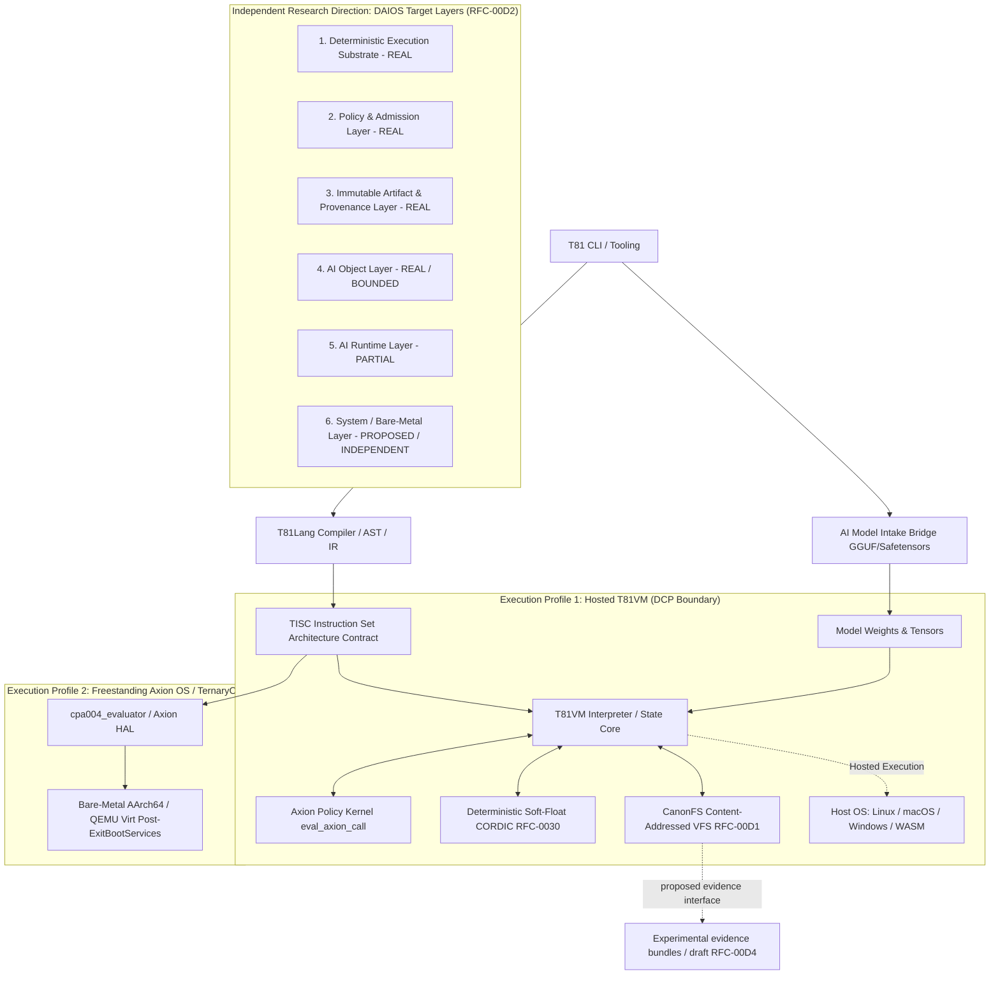

# T81 Research Continuity — SYSTEM_ARCHITECTURE

**Document ID:** `docs/ai-context/SYSTEM_ARCHITECTURE.md`
**Version:** 1.0.1 · **Last Reviewed:** 2026-10-29
**Source Snapshot:** `main` at `f8ac77159ded2c4b93f4cc83abd48f6f35655468` (checked 2026-10-29; refresh before use)
**Status:** Non-normative architecture index; not a complete integration trace or production conformance certificate

---

## 1. Subsystem Architecture Map

T81 has documented policy, runtime, model-intake, and artifact surfaces with different maturity levels. The diagram is a **conceptual map**, not one verified end-to-end call path or a universal claim of bit-exact cross-platform behavior.

---

## 2. Core Subsystems and Responsibilities

### 2.1 TISC Instruction Set Architecture (Computational Contract)
- **Path:** `include/t81/isa/opcodes.hpp`, `src/isa/`, `spec/tisc-spec.md`
- **Role:** The core computational instruction contract defining state transitions on a 64-bit virtual register machine (`STATE = (R, PC, SP, FLAGS, MEM, META)`). It defines opcode semantics across arithmetic, logic, control flow, memory operations, and system interactions.
- **Maturity:** **FROZEN CONTRACT & ACTIVE DUAL-PROFILE TARGET**.
- **Execution Profiles:**
  1. **Hosted Profile (T81VM):** C++ runtime implementing full VM interpretation, JIT exploration, FFI, dynamic Axion policy checks, and CanonFS virtual storage on conventional operating systems.
  2. **Freestanding Profile (Axion OS / HAL):** Freestanding C++ evaluator (`ternaryos/hal/cpa004_evaluator.{hpp,cpp}`) operating directly on bare-metal AArch64 post-`ExitBootServices`, with zero host OS dependencies, static machine allocation (14,816 bytes machine storage, 128-byte stack frames), and streaming JSON serialization.

### 2.2 T81VM Virtual Machine Core (Hosted Execution Profile)
- **Path:** `src/vm/vm.cpp`, `include/t81/vm/vm.hpp`
- **Role:** Deterministic Core Profile (DCP) execution engine on hosted platforms. Decodes TISC bytecode, manages VM memory frames, and enforces pre-dispatch policy checks (`eval_axion_call`).
- **Maturity:** **BETA RUNTIME**. Specific deterministic call paths have reported tests; parity across all programs, features and platforms is not established by this index.

### 2.3 Axion OS / TernaryOS HAL (Freestanding Execution Profile)
- **Path:** `ternaryos/hal/cpa004_evaluator.cpp`, `ternaryos/hal/`
- **Role:** Freestanding TISC execution evaluator embedded into bare-metal UEFI/QEMU boot flows. Evaluates admitted instruction subsets without host C runtime, memory allocators, STL, or dynamic operating system services.
- **Maturity:** **VERIFIED BOUNDED FREESTANDING RUNTIME** (CPA-004/CPA-005: 25 matching state boundaries across hosted and guest runs).

### 2.4 Axion Policy Governance Engine
- **Path:** `src/axion/`, `include/t81/kernel/axion/`
- **Role:** Pre-side-effect access control kernel. Evaluates authorization rules prior to state mutations, filesystem I/O, or external FFI dispatches.
- **Maturity:** **ALPHA GOVERNANCE**. Fails closed; logs explicit rejection reasons in `vm->state().axion_log` on denial.

### 2.5 CanonFS Content-Addressed Identity File System
- **Path:** `src/core/fs/`, `include/t81/fs/`
- **Role:** Content-addressed VFS implementing cryptographic hash verification (CanonHash-81), portable storage mapping (`storage_key_v1` and `snapshot_storage_key_v1` using `h1-<64_hex_digits>` paths), and foreign file system interchange ([RFC-00D1](../../spec/rfcs/RFC-00D1-canonfs-foreign-filesystem-interchange.md)).
- **Maturity:** **BETA IDENTITY FS**. Provides immutable artifact storage, provenance manifests, and export/import contracts (`t81.canonfs-import.v1`, `t81.canonfs-export.v1`).

### 2.6 T81Lang Tooling & Compiler
- **Path:** `src/lang/`, `include/t81/lang/`
- **Role:** High-level source lexer, parser, AST builder, IR generator, and TISC bytecode compiler.
- **Maturity:** **BETA LANGUAGE**. Supports structured control flow, domain assertions, and TISC compilation.

### 2.7 Deterministic Soft-Float Subsystem (RFC-0030)
- **Path:** `src/core/isa/math/`, `vm/determinism/`
- **Role:** Software implementation of transcendental math functions (sin, cos, exp, log, CORDIC) to eliminate platform-dependent `libm` floating-point rounding discrepancies.
- **Maturity:** **FUNCTIONAL / DCP**. Essential for bit-exact cross-platform neural network trace replay.

### 2.8 AI Model Intake & Tensor Bridge
- **Path:** `src/tools/model/`, `tools/cli/ai/`
- **Role:** Metadata bridge for inspecting GGUF and Safetensors model headers, inventorying weight tensors, and packing 2-bit tryte weights (`.t81w`).
- **Maturity:** **METADATA BRIDGE**. Inspects tensor geometry and converts weights; CPU execution uses SWAR emulation.

---

## 3. DAIOS Target Architecture & Layering (RFC-00D2)

Draft/informational [RFC-00D2](../../spec/rfcs/RFC-00D2-daios-target-architecture-and-sequencing.md) **proposes** a six-layer target architecture. It guides planning (*design ahead, implement behind proof*) and does not accept new runtime APIs or certify each layer as integrated.

| Layer ID | Layer Name | Material Implementation Reality | Current Build-Against Scope |
| :--- | :--- | :--- | :--- |
| **Layer 1** | **Deterministic Substrate** | **REAL** | T81VM, DCP determinism, soft-float math (RFC-0030), cross-platform CTest suites. |
| **Layer 2** | **Policy & Admission** | **REAL** | Axion pre-side-effect evaluation, fail-closed policy checks, audit logging. |
| **Layer 3** | **Immutable Artifacts** | **REAL** | CanonFS content-addressed storage, provenance manifests (RFC-00D1). |
| **Layer 4** | **AI Object Layer** | **REAL / BOUNDED** | Bounded family (`assess-fixed`, `route-fixed`, `classify-fixed`). |
| **Layer 5** | **AI Runtime Layer** | **PARTIAL** | Model intake bridge, Safetensors header parsing, deterministic trace cache. |
| **Layer 6** | **System / Bare-Metal** | **DEFERRED** | Bare-metal kernel / TernaryOS deferred until Layers 1–4 are fully stabilized. |

---

## 4. Implementation Maturity Matrix

| Component / Subsystem | Source Path | Target RFC / Spec | Test Verification Target | Maturity Level |
| :--- | :--- | :--- | :--- | :--- |
| **TISC ISA Core** | `src/isa/` | `spec/tisc-spec.md` | CTest #391–396 | **Frozen (v1.9.0)** |
| **T81VM DCP Engine** | `src/vm/` | `spec/vmspec.md` | `vm_determinism_property_test` | **Beta Runtime** |
| **Axion Policy Engine** | `src/axion/` | `spec/rfcs/RFC-00D2-daios-target-architecture-and-sequencing.md` | CTest #154 | **Alpha Governance** |
| **CanonFS Interchange** | `src/core/fs/` | `spec/rfcs/RFC-00D1-canonfs-foreign-filesystem-interchange.md` | CTest #84–85 | **Beta Identity FS** |
| **Soft-Float CORDIC** | `src/core/isa/math/` | `spec/rfcs/RFC-0030-deterministic-math-subsystem.md` | CTest #355 | **Functional / DCP** |
| **Accountable Evidence** | `examples/governance/` | [RFC-00D4 draft](../../spec/rfcs/RFC-00D4-accountable-decision-bundle.md) | Bounded precursor tests; confirm exact CTest invocation | **Experimental / not RFC-conformant by default** |
| **Ternary Hardware RTL** | `rtl/core/` | `t81-hardware` repo | Verilog / SystemVerilog simulation | **Experimental / RTL** |
| **2-Bit MatVec SIMD** | `experiments/` | `PACKED_TERNARY_MATVEC_PERFORMANCE_REPORT.md` | `t81_packed_ternary_matvec` | **Experimental / Frozen** |

---

## 5. Architectural Limitations & Integration Gaps

1. **Software CPU Emulation Tax:** Binary vector ALUs (AVX2/NEON) incur heavy bit-shuffle overhead when unpacking 2-bit tryte fields during MatVec execution, limiting performance to $75.3\%$ of INT8 AVX2.
2. **Durable Witness Isolation:** As demonstrated in `experiments/durable_witness/`, an isolated SQLite WAL witness store remains vulnerable to snapshot rollback unless paired with external monotonic sequence counters or append-only HMAC receipt ledgers.
3. **Draft Interchange Boundaries:** While RFC-00D1 v1 JSON seed contracts are stable enough for tooling, full foreign filesystem interop, symlink postures, and archive bundle exports remain draft surfaces.
4. **Hardware Substrate Disconnect:** RTL in `rtl/core/t81_top.sv` uses 2-bit binary representations per trit; no physical 3-state semiconductor characterization data exists in the repository.
5. **Preserved Normative TISC Discrepancies (Unresolved):**
   - **Memory Operands:** `vm/vm.cpp` and `spec/tisc/opcode-semantics.md` use direct immediate addresses for Load and Store, whereas `spec/tisc-spec.md` specifies register-indirect addressing (`R[RS]`).
   - **Branch Operands:** `vm/vm.cpp` and `spec/tisc/opcode-semantics.md` evaluate immediate branch targets and test register $R[B]$ for JZ/JNZ, whereas `spec/tisc-spec.md` specifies register-indirect targets and FLAGS-based zero testing.
   - **TXor Operation:** Runtime evaluates balanced wrapped difference `((lhs - rhs + 1) % 3) - 1`, while historical prose labels TXor as "XOR / Sum".
   - **Opcode Inventories:** Discrepancy between 174 capability-frozen opcodes, 209 registry entries, and 244 named C++ header opcodes (with undefined opcodes 221–223 and 247–255).

---

## 2026-10-31 architecture boundary note

The reported ADM-2 M1 local branch is not an admitted production layer or a verified end-to-end integration. Do not infer expanded DAIOS layer maturity, Axion authority, or DCP coverage from selected macOS ARM64 CTests or successful translation-unit compilation. Architecture changes require inspected diffs, accepted contracts, and scoped validation.

---

## 2026-11-05 execution-profile boundary and pending ISA contract

**Cross-profile experimental boundary:** CPA-004/005 demonstrated the canonical 351-byte program across hosted T81VM and freestanding Axion/TernaryOS after `ExitBootServices`. CPA-006 expanded the *same implemented semantic profile* to 19 frozen cases, including successful Halt, runtime trap, admission rejection and step-budget exhaustion, with 57 hosted and 57 QEMU executions. The freestanding evaluator and CPA-006 artifacts are on the experimental integration branch, **not on current main**. See [PR #710](https://github.com/t81dev/t81-foundation/pull/710), merged into `experiment/cpa005-integration-base`; [PR #709](https://github.com/t81dev/t81-foundation/pull/709) remains an open draft. Do not infer that main contains the evaluator.

**ISA-001 source-level divergence:** Main normative `spec/tisc-spec.md` describes `Load: R[A] = MEM[R[B]]` and `Store: MEM[R[A]] = R[B]`, whereas hosted VM uses direct A/B logical addresses. Main specification calls for register-derived branch targets and FLAGS-tested conditional predicates, whereas hosted VM uses immediate target A and register-tested JZ/JNZ (JN/JP use flags). Scalar TXor implementation is `wrap3(lhs - rhs)` for trit-clamped operands; documentary 'XOR / Sum' wording is ambiguous. Core capability freeze covers bytes 0–173, while header and registry contain conflicting extension assignments. Optional LLVM/MLIR branch lowering also diverges from hosted VM operand conventions; **do not extend CPA conformance claims to these backends**.

**Proposed, not approved:** One forward versioned authoritative TISC transition contract plus explicit historical CPA-profile interpretation. No implicit reinterpretation of raw 13-byte binaries. The new contract must define operands, tags, flags, PC progression, trap/side-effect ordering, opcode profile admission and artifact-to-profile binding before implementation. Preserve CPA evaluators and evidence byte-for-byte. Architecture layers and DAIOS maturity labels above remain unchanged by this assessment.
