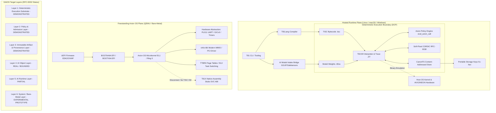

# T81 Research Continuity — SYSTEM_ARCHITECTURE

**Document ID:** `docs/ai-context/SYSTEM_ARCHITECTURE.md`
**Version:** 1.1.0 · **Last Reviewed:** 2026-11-04
**Source Snapshot:** `main` at `d836f7edb9b70608ef7476e82e98a0a89084d74b` (checked 2026-11-04; refresh before use)
**Status:** Non-normative architecture index; not a complete integration trace or production conformance certificate

---

## 1. Subsystem Architecture Map

T81 operates across two distinct execution planes: a mature **Hosted Governed Computing Substrate** running on conventional host operating systems, and an active **Freestanding Axion OS Prototype** running on bare metal or hypervisors via UEFI.

---

## 2. Core Subsystems and Responsibilities

### 2.1 TISC Instruction Set Architecture (v1.9.0)
- **Path:** `include/t81/isa/opcodes.hpp`, `src/isa/`
- **Role:** Frozen 81-opcode instruction set operating on a 64-bit virtual register state machine (`STATE = (R, PC, SP, FLAGS, MEM, META)`).
- **Maturity:** **FROZEN (v1.9.0)**. Opcode values and state encoding are protected against casual modification.
- **Key Opcode Domains:** Arithmetic, logic, flow control, CanonFS I/O, Axion policy calls, and tensor descriptors.

### 2.2 T81VM Virtual Machine Core
- **Path:** `src/vm/vm.cpp`, `include/t81/vm/vm.hpp`
- **Role:** Deterministic Core Profile (DCP) execution engine. Decodes TISC bytecode, manages VM memory frames, and enforces pre-dispatch policy checks (`eval_axion_call`).
- **Maturity:** **BETA RUNTIME**. Specific deterministic call paths have reported tests; parity across all programs, features and platforms is not established by this index.

### 2.3 Axion Policy Governance Engine
- **Path:** `src/axion/`, `include/t81/kernel/axion/`
- **Role:** Pre-side-effect access control kernel. Evaluates authorization rules prior to state mutations, filesystem I/O, or external FFI dispatches.
- **Maturity:** **DEMONSTRATED GOVERNANCE**. Fails closed; logs explicit rejection reasons in `vm->state().axion_log` on denial. Verified on both hosted CLI mutations and VM MetaRefine WriteCode denial (PR #701).

### 2.4 CanonFS Content-Addressed Identity File System
- **Path:** `src/core/fs/`, `include/t81/fs/`, `include/t81/canonfs/`
- **Role:** Content-addressed VFS implementing cryptographic hash verification (CanonHash-81), portable on-disk storage keys (`storage_key.hpp`), and foreign file system interchange ([RFC-00D1](../../spec/rfcs/RFC-00D1-canonfs-foreign-filesystem-interchange.md)).
- **Maturity:** **DEMONSTRATED IDENTITY FS**. Provides immutable artifact storage, provenance manifests, and export/import contracts (`t81.canonfs-import.v1`, `t81.canonfs-export.v1`). Enforces strict separation between public Base-81 IDs and portable on-disk `h1-<hex>` filenames (PR #701, PR #702, PR #703).

### 2.5 T81Lang Tooling & Compiler
- **Path:** `src/lang/`, `include/t81/lang/`
- **Role:** High-level source lexer, parser, AST builder, IR generator, and TISC bytecode compiler.
- **Maturity:** **BETA LANGUAGE**. Supports structured control flow, domain assertions, and TISC compilation.

### 2.6 Deterministic Soft-Float Subsystem (RFC-0030)
- **Path:** `src/core/isa/math/`, `vm/determinism/`
- **Role:** Software implementation of transcendental math functions (sin, cos, exp, log, CORDIC) to eliminate platform-dependent `libm` floating-point rounding discrepancies.
- **Maturity:** **FUNCTIONAL / DCP**. Essential for bit-exact cross-platform neural network trace replay.

### 2.7 AI Model Intake & Tensor Bridge
- **Path:** `src/tools/model/`, `tools/cli/ai/`
- **Role:** Metadata bridge for inspecting GGUF and Safetensors model headers, inventorying weight tensors, and packing 2-bit tryte weights (`.t81w`).
- **Maturity:** **METADATA BRIDGE (PARTIAL)**. Inspects tensor geometry and converts weights; CPU execution uses SWAR emulation.

### 2.8 Freestanding Axion OS & Hardware HAL (RFC-00B0 to RFC-00CF)
- **Path:** `ternaryos/`, `ternaryos/kernel/`, `ternaryos/hal/`, `ternaryos/dev/`
- **Role:** Bare-metal UEFI operating system microkernel booting on x86-64 and AArch64 bare metal and hypervisors (QEMU/VirtualBox).
- **Maturity:** **EXPERIMENTAL PROTOTYPE**. Boots to interactive serial console, manages GICv3 interrupts, hardware timers, modern virtio-blk MMIO/PCI, and TTBR0 page tables.
- **Architectural Boundary:** Does **not** embed T81VM or execute TISC bytecode; executes only raw position-independent AArch64 machine-code stubs (`T81X`).

---

## 3. DAIOS Target Architecture & Layering (RFC-00D2)

Draft/informational [RFC-00D2](../../spec/rfcs/RFC-00D2-daios-target-architecture-and-sequencing.md) **proposes** a six-layer target architecture. It guides planning (*design ahead, implement behind proof*) and does not accept new runtime APIs or certify each layer as integrated.

| Layer ID | Layer Name | Material Implementation Reality | Current Build-Against Scope |
| :--- | :--- | :--- | :--- |
| **Layer 1** | **Deterministic Substrate** | **REAL / DEMONSTRATED** | T81VM, DCP determinism, soft-float math (RFC-0030), cross-platform CTest suites. |
| **Layer 2** | **Policy & Admission** | **REAL / DEMONSTRATED** | Axion pre-side-effect evaluation, fail-closed policy checks, audit logging. |
| **Layer 3** | **Immutable Artifacts** | **REAL / DEMONSTRATED** | CanonFS content-addressed storage, portable storage keys (PR #701), provenance manifests (RFC-00D1). |
| **Layer 4** | **AI Object Layer** | **REAL / BOUNDED** | Bounded family (`assess-fixed`, `route-fixed`, `classify-fixed`). |
| **Layer 5** | **AI Runtime Layer** | **PARTIAL** | Model intake bridge, Safetensors header parsing, deterministic trace cache. |
| **Layer 6** | **System / Bare-Metal** | **EXPERIMENTAL PROTOTYPE** | Bare-metal UEFI kernel (`ternaryos/`) boots on QEMU/VirtualBox; lacks TISC runtime. |

---

## 4. Implementation Maturity Matrix

In accordance with T81-SIA-001 audit standards, subsystem maturity is classified across five rigorous engineering dimensions:

| Component / Subsystem | Source Implementation | Successful Build | Executed Component Tests | Verified End-to-End Integration | Production Readiness | Overall Audit Classification |
| :--- | :---: | :---: | :---: | :---: | :---: | :--- |
| **TISC ISA Core (v1.9.0)** | YES (`isa/`) | YES (CMake C++20) | YES (`test_tisc_isa`) | YES (Compiler & VM) | YES (Frozen spec) | **DEMONSTRATED** |
| **T81Lang Compiler** | YES (`lang/`) | YES (CMake C++20) | YES (`test_t81lang`) | YES (Lowers to TISC) | NO (Hosted CLI only) | **DEMONSTRATED (Hosted)** |
| **T81VM DCP Core** | YES (`vm/`) | YES (CMake C++20) | YES (`vm_determinism_*`) | YES (Executes .tisc) | NO (Experimental runtime) | **DEMONSTRATED (Hosted)** |
| **Axion Policy Engine** | YES (`kernel/axion/`) | YES (CMake C++20) | YES (`canonfs_policy_*`) | YES (Hooks VM & CLI) | NO (Specialized governance) | **DEMONSTRATED (Hosted)** |
| **CanonFS Content VFS** | YES (`fs/`, `canonfs/`) | YES (CMake C++20) | YES (`canonfs_*_test`) | YES (CLI put/snapshot) | NO (Active portability work) | **DEMONSTRATED (Hosted)** |
| **Deterministic Numerics** | YES (`include/t81/`) | YES (Header-only/C++) | YES (`ternary_arith_test`) | YES (Integrated across core) | YES (Spec-governed math) | **DEMONSTRATED** |
| **Freestanding Axion OS** | YES (`ternaryos/`) | YES (EDK2 / LLVM) | YES (QEMU boot tests) | NO (No TISC VM / compiler) | NO (Minimal exokernel) | **EXPERIMENTAL PROTOTYPE** |
| **Hardware HAL & Drivers** | YES (`ternaryos/dev/`) | YES (AArch64/x86_64) | YES (PL011/virtio tests) | NO (Targeted stubs only) | NO (Hypervisor/QEMU shim) | **PARTIAL** |
| **AI Model Intake Bridge** | YES (`inference/`) | YES (CMake C++20) | YES (Header inspection) | PARTIAL (Mock/scalar bridge) | NO (CPU SIMD bounded) | **PARTIAL** |
| **Third-Party Application Env**| NO (POSIX absent) | N/A | N/A | N/A | NO (Unsupported) | **NOT SUPPORTED** |
| **Native Ternary Hardware** | NO (Binary emulated) | N/A | N/A | N/A | NO (PDK blocked ADR-0007) | **BLOCKED** |

---

## 5. Architectural Limitations & Integration Gaps

1. **Freestanding TISC Disconnect:** TISC programs cannot run on Axion OS. The bare-metal kernel lacks a bytecode loader, interpreter, and dynamic memory manager, running only raw `T81X` AArch64 machine-code stubs in EL0.
2. **Binary Hardware Emulation:** All ternary numerics are emulated on conventional binary CPUs (AVX2/NEON/ARM64). Standard PDKs (SkyWater 130nm, ASAP7) lack verified 3-level back-bias models, leaving physical silicon feasibility blocked (ADR-0007).
3. **Software CPU Emulation Tax:** Binary vector ALUs incur heavy bit-shuffle overhead when unpacking 2-bit tryte fields during MatVec execution, limiting performance to $75.3\%$ of INT8 AVX2 in cache.
4. **Absence of General-Purpose OS Facilities:** Axion OS provides no POSIX emulation, no socket networking stack, no dynamic shared object linker, and no hierarchical filesystem beyond raw disk sector blocks.
5. **CanonFS Storage Portability:** Public snapshot IDs and object hashes remain canonical Base-81 strings, but on-disk filesystem keys must use portable `h1-<hex>` names without silent legacy migration (PR #701 merged, PR #702, PR #703 active).

---

## 2026-10-31 architecture boundary note

The reported ADM-2 M1 local branch is not an admitted production layer or a verified end-to-end integration. Do not infer expanded DAIOS layer maturity, Axion authority, or DCP coverage from selected macOS ARM64 CTests or successful translation-unit compilation. Architecture changes require inspected diffs, accepted contracts, and scoped validation.

---

## 2026-11-04 system integration architecture note (T81-SIA-001)

The independent system integration audit (**T81-SIA-001**) conducted at baseline commit `9bbc4453ca136251448201cf9166c2bd167e1f67` clarifies the relationship between the hosted platform and the freestanding kernel:
1. **Hosted Platform is Real, Integrated, and Governed:** Under Linux, macOS, and Windows, T81 functions as an integrated software runtime. T81Lang programs compile to TISC bytecode, run in T81VM, trigger Axion policy evaluations, and store verifiable objects into CanonFS with portable `h1-<hex>` storage keys.
2. **Freestanding Microkernel is an Experimental Prototype:** The bare-metal UEFI kernel under `ternaryos/` boots on QEMU and VirtualBox, initializes UART and virtio-blk, but does **not** host the TISC VM or compiler. It cannot execute T81 applications.
3. **Primary System Integration Target:** Embedding a zero-allocation TISC interpreter into the freestanding microkernel is the single most important integration milestone required to bridge this execution gap.
