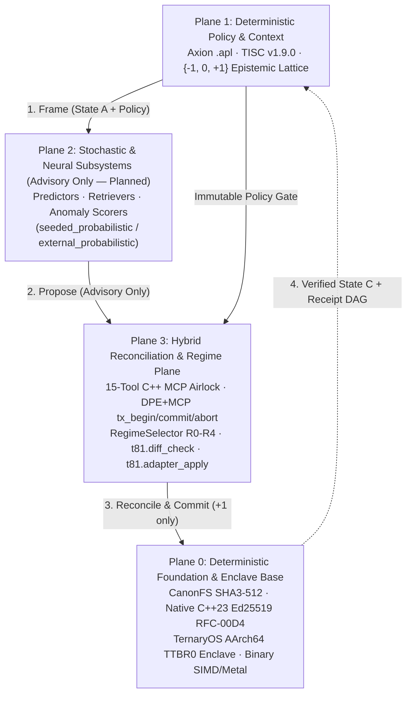

# Stratified Neural-Symbolic AI OS Blueprint

**Status:** Planned / Design Target (Non-Normative Architecture Blueprint)  
**Last Reviewed (UTC):** 2026-11-26  
**Scope:** Horizon D target architecture over T81's frozen deterministic core (`TISC v1.9.0`, `PUBLIC_API_LOCK.json` `v2.2.0`).  
**Authority:** This blueprint is a *design target*, **not** an accepted RFC, production-readiness claim, or assertion that neural OS subsystems are currently implemented. All active research holds (`F01-HOST-BOLQ-v1` `M1–M6 STOP`, `SCG-08 Gate 2` `NO-GO` / PR `#859`, `H01` / Investigation 10A `BLOCKED`, `AXION-AI-001` `HD01–HD06`, and `T81-AIOPT-001 M2` `EXECUTION_BLOCKED`) remain strictly intact.

---

## 1. Architectural Thesis

T81 does **not** compete with binary ALUs on scalar arithmetic, nor does it claim universal ternary superiority or physical ternary silicon advantage. Instead, T81 structures AI-assisted systems execution into a **four-plane stratified neural-symbolic architecture** (`Plane 1` / `Plane 2` / `Plane 3` / `Plane 0`) in which learned or stochastic components are strictly confined to advisory proposals (`Plane 2`) and every durable state transition must traverse deterministic reconciliation (`Plane 3`) before sealing into the content-addressed deterministic base (`Plane 0`).

---

## 2. Four-Plane Stratification

| Plane | Name | Maturity Posture | Core Mechanisms | Write / Commit Authority |
| :--- | :--- | :--- | :--- | :--- |
| **Plane 1** | **Deterministic Policy & Context** | Implemented (Frozen / Stable bounded) | `Axion` `.apl` policy engine (`axion_root.apl`), frozen `TISC v1.9.0` (`0–173` core opcodes), balanced-ternary epistemic lattice (`-1` Deny/Veto, `0` Defer/Abstain/Inert, `+1` Allow/Commit). | Frames immutable policy and `State A` `CanonRef`; never mutated by agents. |
| **Plane 2** | **Stochastic & Neural Subsystems** | **Planned / Design Target** (Advisory only) | Compact learned predictors, semantic retrievers, trajectory/anomaly scorers, external LLM agents. Must declare `reproducibility_class` (`seeded_probabilistic` or `external_probabilistic`, or `deterministic` only for pinned-weight integer/ternary forward passes). | **Zero direct commit authority.** Cannot write to `CanonFS`, `axion_root.apl`, or enclave state directly. |
| **Plane 3** | **Hybrid Reconciliation & Regime Plane** | Implemented (Stable bounded; learned controllers Planned) | 15-tool native C++ MCP Airlock (`t81 mcp serve`), `DPE`+`MCP` transactional isolation (`tx_begin` / `tx_commit` / `tx_abort`), `RegimeSelector` (`R0`–`R4`), Hamming weight-flip auditor (`t81.diff_check`), saturated ternary adapter composition (`t81.adapter_apply`). | Sole reconciliation airlock; rejects direct `Plane 2 → Plane 0` bypass fail-closed and emits `{-1, 0, +1}` verdict. |
| **Plane 0** | **Deterministic Foundation & Enclave Base** | Implemented (Stable bounded / Experimental enclave) | `CanonFS` `SHA3-512` content-addressed store, native C++23 Ed25519 `RFC-00D4` receipt sealing & DAG verification, `TernaryOS` headless AArch64 `TTBR0` security enclave, binary host SIMD (`NEON`/`AVX2`) & Apple Metal unified memory. | Persists sealed `State C` artifacts and receipts atomically (`0` orphan `.stage`/`.bak` files) only on `+1` verdict. |

---

## 3. Subsystem Replacement Matrix (Horizon D — Planned / Design Target)

Every proposed neural OS helper in Plane 2 is paired with a mandatory deterministic guardrail and a compiled, zero-dependency deterministic fallback in Planes 3/0. **None of the Plane 2 neural helpers below are currently implemented or promoted.**

| OS / Control-Plane Subsystem | Plane 2 Neural Role (Advisory Only — Planned) | Mandatory Plane 3 / Plane 0 Deterministic Guardrail | Compiled Deterministic Fallback (Planes 3 / 0) |
| :--- | :--- | :--- | :--- |
| **Scheduler / Dispatch** | Predict optimal kernel regime (`R0`–`R4`) or batch grouping from workload shape & sparsity history. | `RegimeSelector` bounds check, `Axion` capability budget (`max_steps`, `max_memory_bytes`), `max_abs_err == 0`, `dualrail_fallback_count == 0`. | Static empirical `RegimeSelector` (`R0`–`R4` thresholds, `metal_min_work_ops`, `metal_min_nonzero_density = 0.30`). |
| **Storage / Cache** | Prefetch / eviction hints for `SBDR1T2D` weight blocks and `CanonFS` read-heavy subtrees. | `CanonFS` `SHA3-512` object verification (`t81.canonfs_fsck`), immutable object addressing, read-back digest check before admission. | Content-addressed `CanonDualRailRhsCache` LRU/FIFO eviction with `K* = 0` pre-packed `SBDR1T2D` verification. |
| **Semantic Filesystem** | Candidate query expansion / learned embedding proposal over agent memory objects. | Zero-float deterministic `t81.memory_search` top-K verification over Dual-Rail `(P, N)` bitplanes + `SHA3-512` retrieval receipt. | Exact Dual-Rail `(P, N)` popcount top-K scan (`t81.memory_search`) with canonical tie-breaking. |
| **Security / Anomaly Monitor** | Score multi-step agent trajectories for anomalous tool sequences or latent policy evasion. | Fail-closed `Axion` `.apl` policy engine (`axion_root.apl` immutable), `--root` path jail, `{-1, 0, +1}` verdict escalation (neural score may only tighten to `0`/`-1`, never relax a `-1` denial). | Pure deterministic `Axion` rule evaluation + `t81.gate_check` anti-downgrade enforcement floor. |
| **Model Adaptation / IPC** | Propose sparse ternary LoRA / adapter deltas (`SBDR1`) or multi-agent DAG task plans. | `t81.diff_check` Hamming flip-budget (`max_flip_pct`), `t81.adapter_apply` saturated `clamp(W + delta, -1, +1)`, `DPE`+`MCP` disjoint write-set check + TLA+ `TernaryOSTransactions` invariants. | Static `t81.adapter_apply` / `DpeMcpCoordinator` canonical lowest-agent-ID conflict resolution with zero learned routing. |

---

## 4. Five-Step `State A → State C` Transition Lifecycle

Every durable mutation across planes must complete all five stages in order; any failure at stages 1–4 aborts fail-closed with `state_c_ref = null` and `0` orphan staging files:

1. **Frame (`Plane 1 → Plane 2`):** Load immutable `axion_root.apl` (`policy_sha3_512`) and pin the pre-transition `CanonRef` / `SHA3-512` digest of `State A` (`state_a_ref`).
2. **Propose (`Plane 2`):** Generate a candidate mutation, adapter delta, or execution plan in an isolated staging area (`t81.tx_begin` with `isolated: true`). Declare `reproducibility_class` (`deterministic`, `seeded_probabilistic`, or `external_probabilistic`).
3. **Intercept & Reconcile (`Plane 3`):** Evaluate the proposal through deterministic gates: `Axion` `.apl` policy, `t81.diff_check` Hamming flip budget, `RegimeSelector` (`R0`–`R4`) / `T81VM` repeat-determinism check (`repeat_sha3_identical == true`, `max_abs_err == 0`), and transactional write-set disjointness. Emit `transition_verdict_trit ∈ {-1, 0, +1}`:
   - `-1` (`Deny` / Veto): Abort and discard staging; zero state mutation.
   - `0` (`Defer` / Abstain): Escalate or fall back to deterministic Plane 3/0 path; `state_c_ref = null`; zero state mutation.
   - `+1` (`Allow` / Commit): Authorize atomic promotion.
4. **Commit & Attest (`Plane 3 → Plane 0`):** Atomically publish `State C` (`state_c_ref`), remove staging/backup files (`0` orphans), persist `t81.provider.evidence.v1` in `CanonFS`, and seal an `RFC-00D4` receipt node with native C++23 Ed25519 (`< 1 ms`).
5. **Cross-Platform Differential Verification (`Plane 0 → Plane 1`):** Verify bit-exact `state_c_ref`, `RFC-00D4` Ed25519 DAG integrity, and bounded `TISC` payload parity across `AArch64` (`macOS`/`Linux`/QEMU `cortex-a57`) and `x86_64` (`Linux`/`Windows`) CI runners.

---

## 5. Resource Budget (`8 GB` Apple M2 Air + Hosted CI)

To preserve contributor accessibility on `8 GB` unified-memory laptops and standard GitHub Actions runners:

- **Resident Footprint Cap:** Any local Plane 2 neural OS helper prototype **must** stay strictly under **`< 100 MB` resident RSS** (weights + scratch activations combined).
- **Zero Mandatory External Daemon:** Core builds, `ctest`, and deterministic fallback paths must execute with zero network access and zero required external model downloads.
- **Targeted Local Verification:** Heavy cross-platform wheel builds, multi-architecture `x86_64` AVX2 sweeps, QEMU `TernaryOS` runs, and TLC state-space exploration remain delegated to GitHub Actions CI.
- **Promotion Gate:** No Horizon D prototype may replace a Plane 3/0 static heuristic unless CI benchmarks demonstrate a statistically verified improvement over the matched deterministic control while preserving `100%` bit-exact `State A → State C` fallback parity.
