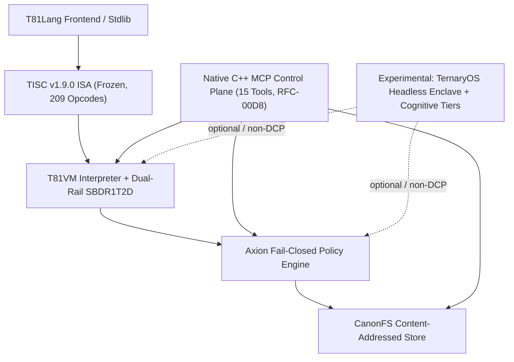
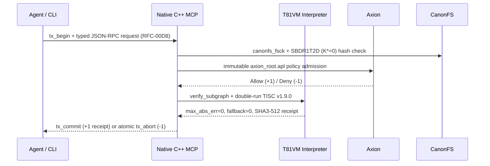

# T81 Architecture Overview

<!-- T81-TOC:BEGIN -->

## Table of Contents

- [T81 Architecture Overview](#t81-architecture-overview)
  - [Purpose](#purpose)
  - [Layer Cake](#layer-cake)
  - [Current State by Layer](#current-state-by-layer)
  - [Four-Plane Stratified Architecture Alignment](#four-plane-stratified-architecture-alignment)
  - [Architecture Navigation Index](#architecture-navigation-index)
  - [Binary Host Execution Boundary & Regime Routing](#binary-host-execution-boundary-&-regime-routing)
  - [Key Invariants](#key-invariants)
  - [Failure Modes](#failure-modes)
  - [Execution Summary](#execution-summary)
  - [Indeterminate](#indeterminate)
  - [Evidence](#evidence)
  - [Acceptance Criteria](#acceptance-criteria)

<!-- T81-TOC:END -->

Status: Active  
Last Verified (UTC): 2026-11-26  
Maturity: Mixed (`Frozen` ISA/types core, `Stable` VM/Axion/CanonFS/MCP control plane, `Experimental` TernaryOS enclave & cognitive tiers)

> **Architecture File Style Guide**
> - Terminology mapping: "Data types" -> `isa/types/` + `include/t81/types/`; "TISC ISA" -> `isa/`; "VM Interpreter & Dual-Rail" -> `vm/`; "Axion Governance Engine" -> `kernel/axion/`; "CanonFS" -> `fs/` + `include/t81/canonfs/`; "Crypto Receipts" -> `src/crypto/ed25519_bundle.cpp`; "MCP Control Plane" -> `tools/cli/core/mcp_server.cpp`; "Experimental tiers" -> `experimental/`.
> - Link style: repo-relative markdown links to concrete files only.
> - Diagram conventions: GitHub-renderable Mermaid only.
> - Maturity labels: `Frozen`, `Stable`, `Experimental`, `Stubbed`, `Planned / Design Target`.
> - Authority: `/spec` > `docs/architecture/OVERVIEW.md` > `/docs` > `/book`.

## Purpose

T81 Foundation is an experimental computing architecture and systems research platform investigating balanced ternary representations (`{-1, 0, +1}`), deterministic execution, fail-closed policy enforcement, content-addressed artifacts, and AI-agent control planes coexisting with conventional binary hosts (`Linux`, `macOS`, `Windows`). This document is the canonical architecture snapshot of its implemented components, layer boundaries, and bounded determinism claim scope.

## Layer Cake

Diagram source: [`diagrams/overview-layer-cake.mmd`](./diagrams/overview-layer-cake.mmd)

## Current State by Layer

| Layer | Primary code | Primary spec | Maturity | Notes |
| :--- | :--- | :--- | :--- | :--- |
| Data types | `isa/types/`, `include/t81/types/` | [`spec/t81-data-types.md`](../../spec/t81-data-types.md) | Frozen | Deterministic-core surface (`PUBLIC_API_LOCK.json` `v2.2.0`). |
| TISC ISA | `isa/` + VM decode/dispatch | [`spec/tisc-spec.md`](../../spec/tisc-spec.md) | Frozen | `TISC v1.9.0` (`0–173` frozen core opcodes, `209` total); opcode semantics/freeze governed. |
| VM interpreter & Dual-Rail | `vm/vm.cpp`, `vm/tensor_helpers.cpp` | [`spec/t81vm-spec.md`](../../spec/t81vm-spec.md) | Stable | DCP includes interpreter path (not JIT); `SBDR1T2D` fast-path + `DualRailTelemetry` (`fallback_count == 0`); 2B BitNet chunked streaming & Metal `R3` dispatch. |
| Axion governance | `kernel/axion/` | [`spec/axion-kernel.md`](../../spec/axion-kernel.md) | Stable (bounded) | Fail-closed policy verdicts (`axion_root.apl`) integrated in VM step path before side effects. |
| CanonFS & Ed25519 receipts | `fs/`, `include/t81/canonfs/`, `src/crypto/ed25519_bundle.cpp` | [`spec/supplemental/canonfs-spec.md`](../../spec/supplemental/canonfs-spec.md) | Stable (bounded) | Content-addressed `SBDR1T2D` (`K* = 0`), RFC-00D1 interchange, native C++23 Ed25519 `RFC-00D4`/`00D6` receipt DAGs, and offline `t81 receipt export` bundles. Integrity does not establish provenance truth. |
| Native C++ MCP & DPE control plane | `tools/cli/core/mcp_server.cpp`, `tools/cli/core/main.cpp` | [`TERNARYOS_ARCHITECTURE_v0.2.md`](../research/proposals/TERNARYOS_ARCHITECTURE_v0.2.md) | Stable (bounded) | 15-tool `RFC-00D8` compact JSON-RPC server, `--root` jail, `DPE`+`MCP` `tx_begin`/`tx_commit`/`tx_abort` isolation (TLA+ `DpeBatchCommit`), KEV/advisory fail-closed gating, `t81==2.2.0` Python M3 SDK. |
| TernaryOS enclave & experimental tiers | `ternaryos/`, `experimental/` | [`TERNARYOS_BOOT_TO_RECEIPT_CONTRACT_v0.1.md`](../research/proposals/TERNARYOS_BOOT_TO_RECEIPT_CONTRACT_v0.1.md), [`spec/cognitive-tiers.md`](../../spec/cognitive-tiers.md) | Experimental / Stubbed | Headless AArch64 `TTBR0` enclave (`t81 enclave run`) & cognitive tiers; not part of DCP guarantees or general-purpose OS readiness. |

## Four-Plane Stratified Architecture Alignment

Post-Wave 5 runtime surfaces map onto the four-plane stratified model codified in [`AI_OS_STRATIFIED_BLUEPRINT.md`](./AI_OS_STRATIFIED_BLUEPRINT.md) (`DEC-004` in [`DECISIONS_AND_GOVERNANCE.md`](../ai-context/DECISIONS_AND_GOVERNANCE.md)):

- **Plane 1 — Deterministic Policy & Context (Implemented, Frozen / Stable bounded):** Immutable `Axion` `.apl` policy engine (`axion_root.apl`), frozen `TISC v1.9.0`, and `{-1, 0, +1}` epistemic lattice (`-1` Deny, `0` Defer/Abstain, `+1` Allow/Commit).
- **Plane 2 — Stochastic & Neural Subsystems (`Planned / Design Target` — Horizon D, Advisory Only):** Future compact neural OS helpers (`< 100 MB` RSS cap on `8 GB` M2 hosts) and external agents. **Not currently implemented**; zero direct write/commit authority to `CanonFS`, `axion_root.apl`, or enclave state.
- **Plane 3 — Hybrid Reconciliation & Regime Routing (Implemented, Stable bounded):** 15-tool native C++ MCP airlock (`t81 mcp serve`), `DPE`+`MCP` transactional coordinator, `RegimeSelector` (`R0`–`R4`), `t81.diff_check`, `t81.adapter_apply`, and KEV/advisory fail-closed containment.
- **Plane 0 — Deterministic Foundation & Enclave Base (Implemented, Stable bounded / Experimental enclave):** `CanonFS` `SHA3-512` object store, native C++23 Ed25519 `RFC-00D4`/`00D6` receipt sealing & DAG verification, `t81 receipt export` offline forensic bundles, `t81 enclave run`, and binary SIMD (`NEON`/`AVX2`) + Apple Metal unified memory kernels.

All active research holds and negative results remain strictly preserved: `F01-HOST-BOLQ-v1` (`M1–M6 STOP`), `SCG-08 Gate 2` (`NO-GO` / PR `#859`), `H01` / Investigation 10A (`BLOCKED`), `AXION-AI-001` (`HD01–HD06`), `T81-AIOPT-001 M2` (`EXECUTION_BLOCKED`), `10.6×` slower software tryte addition, and `75.3%` INT8 in-cache MatVec.

## Architecture Navigation Index

- **Stratified AI OS Blueprint (Planned Horizon D):** [`AI_OS_STRATIFIED_BLUEPRINT.md`](./AI_OS_STRATIFIED_BLUEPRINT.md)
- **Full Architectural Narrative:** [`T81_ARCHITECTURE_REPORT.md`](./T81_ARCHITECTURE_REPORT.md)
- **Directory Index & Standards:** [`README.md`](./README.md), [`ARCHITECTURE_DOC_STANDARD.md`](./ARCHITECTURE_DOC_STANDARD.md), [`DEPENDENCY_FIREWALL.md`](./DEPENDENCY_FIREWALL.md), [`system_map.yaml`](./system_map.yaml)
- **Layer & Cross-Cutting Specs:** [`layers/README.md`](./layers/README.md), [`cross-cutting/README.md`](./cross-cutting/README.md), [`diagrams/README.md`](./diagrams/README.md), [`adr/`](./adr/)
- **Roadmap & Live Session Context:** [`docs/ROADMAP.md`](../ROADMAP.md), [`docs/ai-context/START_HERE.md`](../ai-context/START_HERE.md), [`docs/ai-context/CURRENT_STATE.json`](../ai-context/CURRENT_STATE.json)

## Binary Host Execution Boundary & Regime Routing

T81 executes **ternary semantics on binary hardware** in a coexistence model: binary hosts handle general OS duties while `T81VM` executes policy-governed, bit-exact (`max_abs_err == 0`) ternary compute:

- **Packed & Dual-Rail Representations:** Supports 2-bit packed trits (`4` trits/byte) and `DualRail_PN_64` / `SBDR1T2D` (`128`-trit block-sparse Dual-Rail, `0.25` bytes/trit, `K* = 0` pre-packed).
- **Evidence-Bounded `R1`/`R2` Regime Routing (Measured on Apple M2 `arm64`, Ledger `10` accepted `+1` / `16` negative `-1`):**
  - `R1` (ternary activations × ternary weights): `CPU_1T_SBDR128_SIMD` at `M == 1, s >= 90%`; Metal `GPU_R1_BitmaskSkip_Pop` at `s >= 75%` (`M >= 4` or `M == 1, 75% <= s < 90%`); Metal `GPU_R1_DualRail_Pop` otherwise.
  - `R2` (`int8` activations × ternary weights): `CPU_4T_INT4W` (`M = 1..4`) / `CPU_4T_INT8W` (`M >= 16`). Dual-Rail unpacking for `R2` is a confirmed negative (`cpu_dualrail_unpack`), as are CSR Metal sparse (`gpu_csr_sbdr128_sparse`), 2-block unrolling (`2block_unroll_sbdr128`), and per-layer CPU thread barriers (`per_layer_cpu_thread_barrier`).

## Key Invariants

1. Determinism claims are bounded to verified surfaces in [`DETERMINISTIC_CORE_PROFILE.md`](../product/DETERMINISTIC_CORE_PROFILE.md) and [`DETERMINISM_SURFACE_REGISTRY.md`](../governance/DETERMINISM_SURFACE_REGISTRY.md).
2. VM execution is policy-aware and fail-closed: interpreter dispatch and MCP commit paths evaluate immutable `Axion` policies before protected side effects.
3. Fault behavior is explicit trap semantics (`include/t81/vm/traps.hpp`, e.g., `SecurityFault`, `trap_code: 6`), not undefined behavior.
4. Governed Dual-Rail paths enforce `max_abs_err == 0`, `dualrail_fallback_count == 0`, explicit `dualrail_sparse128_blocks_skipped` telemetry, and `repeat_sha3_identical == true`.
5. Dependency boundaries are governed by [`DEPENDENCY_FIREWALL.md`](./DEPENDENCY_FIREWALL.md).

## Failure Modes

- **Policy Violation / Tamper (`-1`):** Unauthorized tensor hash, missing fail-closed Axion event reason, or agent attempt to mutate `axion_root.apl` traps fail-closed (`SecurityFault`, `ERR_IMMUTABLE_POLICY_ROOT`, `ERR_POLICY_HASH_DENIED`).
- **Storage & Header Corruption (`-1`):** Tampered `CanonFS` `.blk` objects (`ERR_CANONFS_FSCK_FAILED`) or non-zero `K*` / malformed `SBDR1T2D` headers (`ERR_SBDR1T2D_INVALID`) abort before VM execution.
- **Transactional Conflict & Budget Breach (`-1`):** Concurrent peer `tx_commit` races (`ERR_TX_CONFLICT`), `max_abs_err != 0`, `dualrail_fallback_count != 0`, or `repeat_sha3_identical != true` trigger atomic `tx_abort` with zero partial side effects.

## Execution Summary

Diagram source: [`diagrams/governance-axion-sequence.mmd`](./diagrams/governance-axion-sequence.mmd)

## Indeterminate

- Full JIT/interpreter semantic equivalence status is not asserted here.
- Universal cross-platform bit-identity for all floating-point transcendental behavior is not asserted here.
- **Native `x86_64` AVX2 Scope & Boundary (Updated 2026-11-26):** Native `x86_64` AVX2 `R1` (ternary activations × ternary weights) measurements were recorded on `Intel(R) Xeon(R) 6975P-C` (`ubuntu-24.04`, `480 MiB` L3, `-O3 -march=native`) in PR `#863` (Run `#45325242627`, in-L3 `L = 64`) and PR `#864` (Run `#45328018712`, off-L3 `> 480 MiB` DRAM sweep). Off-L3 `SBDR128_SIMD` measured **`2.58×–2.88×`** faster per layer than `INT8_Sparse128` (`74.85 / 36.86 / 17.01 µs/L` vs `192.97 / 105.36 / 48.91 µs/L` at `50% / 75% / 90%` sparsity) with a confirmed `2.20×` L3→DRAM cliff on `DualRail_Dense` (`22.72 → 10.31 GB/s`). These results are single-thread software `R1` measurements only; `R2` (`int8` activations) Dual-Rail CPU unpack remains a confirmed negative (`cpu_dualrail_unpack`), multi-threaded `x86_64` sparse scaling remains unmeasured (`0`), and software bandwidth gains do not establish physical ternary silicon advantage.

## Evidence

- [`docs/records/status-history/AVX2_L3_VS_OFF_L3_DRAM_CROSSOVER_2026-11-24.md`](../records/status-history/AVX2_L3_VS_OFF_L3_DRAM_CROSSOVER_2026-11-24.md)
- [`vm/vm.cpp`](../../vm/vm.cpp)
- [`vm/tensor_helpers.cpp`](../../vm/tensor_helpers.cpp)
- [`include/t81/vm/vm.hpp`](../../include/t81/vm/vm.hpp)
- [`include/t81/vm/state.hpp`](../../include/t81/vm/state.hpp)
- [`kernel/axion/policy_engine.cpp`](../../kernel/axion/policy_engine.cpp)
- [`fs/persistent_driver.cpp`](../../fs/persistent_driver.cpp)
- [`fs/canonfs_interchange_ops.cpp`](../../fs/canonfs_interchange_ops.cpp)
- [`tools/cli/core/mcp_server.cpp`](../../tools/cli/core/mcp_server.cpp)
- [`examples/research/agent-receipt-sidecar/routing_ledger.py`](../../examples/research/agent-receipt-sidecar/routing_ledger.py)
- [`tests/qemu/test_boot_to_receipt_contract.py`](../../tests/qemu/test_boot_to_receipt_contract.py)
- [`tests/qemu/test_ternaryos_v02_semantics.py`](../../tests/qemu/test_ternaryos_v02_semantics.py)
- [`docs/product/DETERMINISTIC_CORE_PROFILE.md`](../product/DETERMINISTIC_CORE_PROFILE.md)
- [`docs/governance/DETERMINISM_SURFACE_REGISTRY.md`](../governance/DETERMINISM_SURFACE_REGISTRY.md)
- [`docs/status/IMPLEMENTATION_MATRIX.md`](../status/IMPLEMENTATION_MATRIX.md)

## Acceptance Criteria

- Every non-trivial claim maps to at least one item in **Evidence**.
- Implemented vs experimental surfaces are explicitly separated.
- Negative results (`-1`) and unmeasured/indeterminate areas (`0`) are preserved honestly.
- Diagrams render in GitHub Markdown (Mermaid).
- Determinism statements are bounded to DCP/registry language.
