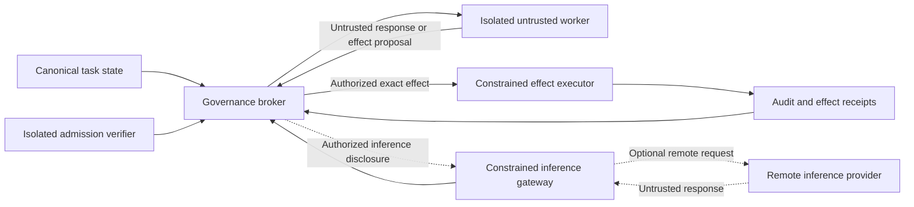

# ADR-0007: AXION-AI-001 ADR-001 — Isolated Interchangeable AI Workers

Status: Proposed — NON-NORMATIVE candidate for independent review
Date: 2026-11-17
Last Updated: 2026-11-17
Version: 0.1.0
Maturity: Experimental
Research identifier: AXION-AI-001 ADR-001
Repository baseline: `56db3a18909a029042f7ceded2e19d96aec57cdc`

## Purpose

Prepare a reviewable Design B architecture: a fail-closed governance broker,
isolated interchangeable AI workers, a separate model-binding envelope and
explicit effect accounting. Model replacement preserves task records and
governance authority without assuming portable model internals.

Human authorization in the authoring session approves Design B as the **preferred
research architecture only**, and authorizes this documentation candidate. It
does not normatively adopt the design or authorize implementation, qualification,
experiments or merge. The user reports Gemini's independent adversarial review;
the original review artifact and authenticated reviewer identity were not
supplied. Codex authored this candidate and the earlier proposal; this is not
an independent review or scientific replication of its own work. Model identity
for the authoring agent is not asserted beyond that attribution.

## Scope

This is Track F / canonical H07 supporting architecture research, with H08
provenance boundaries. It does not redefine H01–H08, historical Hanoi/CWEB
lineage, research priorities, frozen ISA behavior or production interfaces.
Hosted T81VM/Axion and experimental Axion OS remain distinct execution profiles.
No remote-provider, model-quality, ternary-advantage or production-readiness
claim follows. Relevant authority remains `/spec` >
`docs/architecture/OVERVIEW.md` > `/docs` > `/book`.

**Unchanged F01 holds:** BOLQ NOT ADOPTED; residual risks NOT ACCEPTED; M1–M6
STOP; `linux_relock_required=true`. The operative F01 protocol SHA-256 remains
`d48aeedc924cf505cab8a7fed316fc84d8f2c259dd502fd1d0a7fe8432f05de3`.
No F01 receipt meaning, resource ceiling, qualification gate or authorization
changes. AXION-AI-001 borrows no F01 execution permission or budget.

## Context: implemented vs experimental boundary

Claim classifications throughout this document are:

- **IMPLEMENTED:** implementation source exists; this label alone says nothing
  about execution or qualification.
- **STATICALLY VERIFIED:** the stated source path or document contract was
  inspected at the baseline.
- **DYNAMICALLY VERIFIED:** execution demonstrated the behavior; none is claimed
  in this preparation.
- **PROPOSED:** a new architecture contract, not operative behavior.
- **UNSUPPORTED:** inspected evidence does not establish the stated guarantee.

**Every decision, ABI, schema outline, state machine, invariant and acceptance
criterion below is PROPOSED unless explicitly classified otherwise.**

| Classification | Existing evidence and implication |
|---|---|
| IMPLEMENTED / STATICALLY VERIFIED | Hosted `AxionContext` uses an allow-all default and also allows with a missing engine. The broker cannot inherit these defaults. [E01] |
| IMPLEMENTED / STATICALLY VERIFIED | The optional llama.cpp adapter loads the model before hashing its file; inference policy evaluation occurs later. This does not establish the proposed admission boundary. [E02] |
| IMPLEMENTED / STATICALLY VERIFIED | CanonFS checks authorization before driver mutations. That alone does not establish atomicity across concurrent revocation, mutation and durable audit evidence. An absent hook permits the driver's operation. [E03] |
| STATICALLY VERIFIED | RFC-00D3 closes both the manifest root and provenance key sets. Its optional source digest is a nonempty string, not a complete authenticated asset-binding contract. [E04] |
| IMPLEMENTED / STATICALLY VERIFIED | `AgentInvoke` is a governed VM call path, not a general model-provider protocol. Axion OS has separate capability, IPC and service interfaces. [E05], [E06] |
| UNSUPPORTED | Universal inference reproducibility, interchangeable model internals, exactly-once remote effects, general CanonFS/revocation transaction atomicity and universal kill/reap latency are not established by this ADR or source existence. |

## Decision

### 1. Fail-closed broker initialization and session-local audit

The broker lifecycle is:

```text
UNINITIALIZED -> POLICY_READY -> SESSION_READY -> ACTIVE
any initialization failure -> BLOCKED
ACTIVE integrity/evidence failure -> FENCED
```

Entering ACTIVE requires an explicitly selected policy implementation,
successfully parsed policy, immutable policy identity and initial epoch;
authenticated configuration authority; initialized capability store, aggregate
budget ledger and effect sequencer; session-local audit state and evidence
reservation; required persistence facilities; and authenticated, generation-bound
worker/executor channels. No model supplies policy or grants authority.

Missing configuration, policy evaluation exceptions, unavailable policy services
and all verdicts other than explicit Allow deny the operation. No default
`AxionContext` construction or allow-all fallback is admissible.

Each session owns its sequence, previous-event digest, task/effect ledgers and
budget reservations. A process-global counter is insufficient. Events bind the
session and broker incarnation. Recovery verifies continuity before admission;
outstanding effects and reservations are not reset. Referenced policy/capability
state is evidence, not an executable grant. Hashes establish identity rather
than authority, provenance authenticity or truth.

### 2. Trust-boundary model and immutable model admission

| Component | Authority and trust |
|---|---|
| Governance broker | Trusted policy, identity, task-state and sequencing logic. Parses only the bounded application wire protocol. No native model or tokenizer parser. |
| Artifact custodian and isolated manifest verifier | Trusted admission components in separate address spaces. Bounded snapshot/hash and pinned-schema validation; authenticated identities and receipts. |
| Model worker | Untrusted. All model-format parsing, tokenization/template processing and native inference occur here. No privileged broker handles or effect credentials. |
| Effect executor / inference gateway | Separate trusted components with only reviewed operations or exact authorized inference egress. Reject direct model calls and cannot independently mint authority. |
| Remote inference service | External trust domain; model assertions remain provider claims unless independently verified. |
| Audit/storage substrate | Trusted only for explicitly demonstrated integrity, atomicity and durability properties. |

The proposed primary view is:



The remote gateway is a separate constrained trusted executor, not ambient
network access for an untrusted worker. All outbound inference disclosure is
separately authorized and bound to exact request bytes/destination. The dashed
path gives no model direct tools, arbitrary egress or kernel authority. The broker
authenticates the actual peer; self-declared IDs and verifier receipts from an
untrusted worker cannot establish admission.

Pre-admission sequence:

1. Acquire bounded private snapshots of the manifest and all referenced assets.
   Original paths are not runtime worker inputs.
2. Validate the legacy manifest against pinned RFC-00D3 in the isolated verifier.
3. Validate the separately versioned binding envelope described in section 3.
4. Hash exact bytes and verify the complete asset set, roles, sizes and digests.
5. Evaluate admission policy, including provenance/signer rules where required.
6. Supply read-only access to those same admitted immutable snapshots.

A read-only descriptor does not establish immutability if another writer can
mutate the backing object. The host profile needs demonstrated snapshot or
equivalent protection, including shard, tokenizer, template, configuration and
auxiliary assets. Reopening original paths after verification is prohibited.
Unsupported immutability blocks admission. Schema validity and matching hashes
do not make an asset benign; native parsing remains isolated after admission.

### 3. RFC-00D3 conflict and external binding envelope

If the **same JSON object** must satisfy unchanged `t81.model-manifest.v1` and
contain new top-level binding/tokenizer keys, the requirements conflict: the
schema has `additionalProperties:false`. Its provenance object is also closed.
This argument assumes the unchanged schema version, object boundary and
validation rules; it is not a claim that two distinct objects cannot coexist.
The v1 source digest field does not itself validate an authenticated complete
asset tree. [E04]

| Alternative | Proposed treatment |
|---|---|
| Versioned external binding envelope — preferred | Preserve legacy bytes and validation. A new object references their exact digest and binds assets, tokenizer, template, runtime profile and admission provenance. Validate both independently. |
| Prospective manifest schema revision | Requires a new identifier/version, explicit normative proposal, compatibility review and producer/consumer migration. Do not broaden or reinterpret v1 in place. |

Provisional `axion.ai.model-binding.v1` fields are: exact legacy-manifest byte
digest and pinned schema identity; ordered asset roles/identifiers/byte lengths/
algorithm-qualified digests; tokenizer/template/configuration identities;
runtime/adapter requirements; provenance assertions with verification status;
and a domain-separated canonical-envelope digest excluding its own digest field.
Canonicalization and the signature payload require review before implementation.

Legacy `source_path` is historical metadata, not an authorized locator. Never
present the envelope as a v1 manifest or infer weight contents from tensor
summaries. This is an external admission contract proposal, not a v1 amendment.

### 4. Adapter ABI v1 draft

This is a bounded wire protocol, not a native C++ plugin ABI. Proposed methods
are Discover, Prepare, Generate, Cancel, Quiesce and Close. Capability discovery
is descriptive, never a grant. Unsupported required features fail explicitly.

| Required identity field | Contract |
|---|---|
| `abi_version`, `operation` | Exact protocol version and method. |
| `boot_generation` | Trusted host boot identity plus broker incarnation; restart never reuses the namespace. |
| `session_id`, `task_id` | Broker-issued governance scope. |
| `worker_id`, `worker_generation` | Authenticated endpoint and monotonically advancing activation generation. |
| `request_id`, `attempt_sequence` | Stable logical request and explicit attempt; no implicit retry or new allowance. |
| `model_identity` | Local binding digest or explicitly weaker remote identity record. |
| `tokenizer_identity` | Verified identity or explicit claimed/unknown remote status permitted by policy, never a fabricated digest. |
| `policy_epoch`, `policy_ref` | Exact admission policy content/version. |
| `capability_refs` | Broker-owned grant IDs and versions; not bearer authority. |
| `budget` | Reservation identity, limits, units, scope and remaining allocation. |
| `input_ref`, `parameters` | Canonical input and all effective decoding/tool/template parameters. |
| `context_admission_ref` | Generate binds the section 7 admission record for this exact state and destination; a missing, stale or mismatched record blocks generation. |
| `request_digest` | Domain-separated binding of every interpretation-bearing field above. |

Responses echo the complete identity and carry bounded stream sequence numbers
and one terminal disposition. Authentication binds the real peer, not echoed
strings. Reject duplicate, stale, mismatched and out-of-order terminal messages.
Specify canonical framing, numeric representation, unknown-field rules, byte
bounds and ownership before implementation. No native pointers; overflow fails
closed. Remote model names alone do not establish weight identity.

An old policy epoch cannot authorize a new effect commitment. Reauthorization is
explicit and recorded; never silently rewrite a request. Selective revocation
changes the targeted grant's validity/version, not unrelated grants merely
sharing a policy epoch. Provider discovery includes task/modality, context,
tokenizer/template, tool/structured-output, cancellation and backend limits;
advertised properties remain distinct from independently verified properties.

### 5. Authorization, revocation and local effect commitment

One authoritative broker sequencer orders policy updates, capability changes,
effect commitments and fences. Define R(c) as committed revocation of capability
c; C(e) as local atomic effect commitment; D(e) as committed external dispatch
authorization/entry into the handoff-possible window in section 6.

Inference approval permits computation only. Each later effect binds exact
arguments, destination, source response, capability versions and reservation.
The proposed local transaction validates these under current policy and commits
the mutation plus required effect/audit record atomically with respect to R(c).

```text
validate exact effect + current policy/capabilities + budget
                         |
atomic mutation + required effect/audit record commitment
```

- R(c) before C(e): reject e when it depends on c.
- C(e) before R(c): retain the committed effect; revocation is not retroactive.
- Concurrent operations resolve to one order with recoverable evidence.

**UNSUPPORTED:** the baseline supplies a general CanonFS primitive establishing
this complete property. [E03] A future executor must demonstrate transactional,
crash-recovery and durability semantics. Otherwise reject atomicity-required
operations as unavailable. Authorized private staging needs its own grant and
budget; calling it staging does not exempt writes from authorization.

For external operations only local admission and D(e) share the broker order:
R(c) before D(e) prohibits arming/handoff. D(e) before R(c) is in flight and can
complete remotely after revocation. No global broker lock is held over blocking
network I/O. D(e) is not evidence of physical send or remote execution.

**UNSUPPORTED:** atomic commitment between the local ledger and arbitrary remote
systems, exactly-once remote execution, or universal prevention after local
revocation. Stricter profiles need separately reviewed cooperating receiver
semantics; without support, reject operations requiring that guarantee. Disable
implicit transport retries and destination-changing redirects unless separately
authorized as explicit attempts, with unchanged aggregate budget attribution.

### 6. External-effect and dispatch-progress state machines

Track two distinct axes. **Effect outcome** retains the six original names:

| Outcome | Meaning |
|---|---|
| NOT_DISPATCHED | No handoff-possible window entered; absence is established, not inferred from a missing marker. |
| DISPATCHED | Dispatch authorization/barrier committed; handoff may have been attempted. This is not confirmed delivery. |
| CONFIRMED | Evidence satisfies the admitted confirmation contract for the identified effect; not necessarily business success. |
| DENIED | Broker refused permission before handoff was possible. |
| FAILED | Conclusive evidence establishes terminal failure without the effect occurring. |
| UNCERTAIN | Available evidence cannot establish the effect's outcome. |

**Dispatch progress** records durable intent separately from possible handoff:

| Phase | Meaning and live outcome |
|---|---|
| NONE / INTENT_PENDING | Fresh request or intent being persisted; egress gate remains closed. NOT_DISPATCHED only while exclusive control establishes no handoff. |
| INTENT_DURABLE | Valid intent and required persistence receipt exist. Gate is still closed. This alone does not demonstrate handoff or prove its absence after a crash. |
| HANDOFF_ARMED | Required write-ahead handoff authorization and persistence receipt exist; D(e) commits here. Outcome is conservatively DISPATCHED even if actual handoff has not happened yet. |
| HANDOFF_CONFIRMED | Independently admissible evidence proves the exact handoff occurred. Still DISPATCHED unless evidence also establishes an effect outcome. |
| NO_HANDOFF_PROVEN | Positive admissible evidence establishes no attempt and closes every eligible executor generation; NOT_DISPATCHED, DENIED or FAILED according to the underlying decision. |

Before native/remote executor handoff, persist INTENT_DURABLE then HANDOFF_ARMED
under the required storage contract. If either persistence operation fails,
do not open the live egress gate. A marker includes exact effect/request identity,
generation, phase, sequence, previous-record digest and integrity check; integrity
checks detect damage but do not establish successful persistence or authenticity.
The executor accepts only its authenticated, exact, single-use armed grant.
Independent evidence means evidence admissible under the reviewed trust profile,
not another unsupported summary from the same worker.

#### Correction 1: torn dispatch-marker recovery

Recovery fences admission and egress before inspecting retained records. Reconcile
the journal, reservations, persistence receipts, executor generation/lease state
and independently admissible handoff/effect evidence. A valid record prefix or
absent marker alone never establishes that a later attempted handoff was absent.

| Recovery evidence | Required classification |
|---|---|
| Durable intent, no demonstrated handoff, and positive NO_HANDOFF_PROVEN evidence | Recover NOT_DISPATCHED, or a supported pre-handoff DENIED/FAILED outcome. Intent persistence is not delivery evidence. |
| Durable intent without demonstrated handoff, but no positive no-attempt proof | UNCERTAIN. Absence of a handoff marker is insufficient. |
| Handoff definitely not attempted | Requires a complete admissible no-attempt witness: exclusive gate stayed closed, no armed grant escaped, all executor generations accounted for/fenced, and the exact terminal decision is retained. Only then recover the supported pre-handoff outcome. |
| Handoff possibly attempted: armed grant, interrupted call, lost acknowledgement or unknown executor state | UNCERTAIN unless admissible effect evidence resolves it. Never roll back to NOT_DISPATCHED, DENIED or FAILED by assumption. |
| Handoff independently confirmed, effect unconfirmed | Retain HANDOFF_CONFIRMED; recover effect outcome UNCERTAIN until confirmation/reconciliation establishes more. |
| Missing, torn, partially persisted, mismatched or ambiguous intent/handoff marker | UNCERTAIN for every identifiable possibly dispatched effect, absent positive admissible resolution. Checksum failure is not proof of non-dispatch. |
| Journal damage prevents identifying all at-risk effects or reservations | Session evidence is INCOMPLETE; keep global dispatch STOP, retain damaged bytes and known records, and report the unidentified exposure. Do not invent effect IDs or terminal receipts. |

A no-attempt witness is a demonstrated trust-profile obligation, not an assumed
feature of a filesystem, cancellation API or hash. If that witness cannot be
provided, use UNCERTAIN. Contradictory records fence the session and require
independent reconciliation; they do not produce success. Physical termination of
a local executor does not prove it never handed off an external operation.

The allowed outcome transitions are:

```text
NOT_DISPATCHED -> DENIED | FAILED | DISPATCHED
DISPATCHED -> CONFIRMED | FAILED | UNCERTAIN
UNCERTAIN -> CONFIRMED | FAILED  [new admissible reconciliation evidence]
```

Recovery may additionally reclassify any purported pre-handoff outcome as
UNCERTAIN when its absence evidence is missing, torn or contradicted. This is
an evidence correction, not a new dispatch or an erased historical transition.
CONFIRMED/FAILED terminal conclusions require the stated confirmation contract;
contradictions retain history and block acceptance pending review.

Timeout, connection loss, local crash, revocation or cancellation acknowledgement
after arming cannot establish DENIED/FAILED without conclusive absence evidence.
Provider request acceptance is not completion. Compound effects need separate
effect units or an admitted remote atomic contract. Preserve partial effects;
append resolution rather than erase uncertainty. Never automatically retry an
uncertain operation. No exactly-once remote execution claim is made.

### 7. PortableTaskStateV1 and replacement admission

This is a closed application-schema proposal, not an active JSON Schema:

```text
PortableTaskStateV1 = closed object {
  schema: "axion.ai.portable-task-state.v1",
  task_id: Identifier,
  revision: UInt64,
  parent_state_ref: ContentRef | null,
  task_profile_ref: ContentRef,
  messages: CanonicalMessage[],
  typed_task_data: SchemaBoundData,
  artifact_refs: ClassifiedArtifactRef[],
  policy_state_refs: PolicyStateRef[],
  effect_receipts: EffectReceiptRef[],
  pending_effect_refs: EffectLedgerRef[],
  budget_ledger_ref: ContentRef,
  transformation_refs: StateTransformationRef[],
  replacement_admission_refs: ContextAdmissionRef[]
}
```

- CanonicalMessage: role, ordered typed content parts, provenance and attachment
  references; not a rendered prompt or token sequence.
- SchemaBoundData: pinned task schema plus validated canonical data; not an
  unrestricted backend-state blob.
- ClassifiedArtifactRef: algorithm-qualified identity, size, media/type profile
  and disclosure classification.
- PolicyStateRef: historical policy/capability state, never restored authority.
- Effect references: immutable receipts and authoritative pending/uncertain
  effect-ledger references.
- StateTransformationRef: authorized compaction/derivation record binding exact
  parent and child states, policy/approver identity, retained provenance and any
  loss/uncertainty. An empty list means no transformations, not implicit approval.
- ContextAdmissionRef: exact destination model/tokenizer/template/tool/attachment
  renderer identities, source state revision/digest, effective context ceiling,
  complete input/overhead counts, reserved output and admission decision.

Every type needs closed keys and size bounds. The last two lists reference
evidence, not portable rendered prompts, token IDs, KV caches or grants. Imported
state undergoes current admission/authorization. Cross-model token IDs, KV
caches, hidden state, sampler internals and model-specific session handles are
excluded. Backend checkpoints would require a separate nonportable contract.
Do not fabricate undisclosed reasoning as portable state or audit evidence.

#### Correction 2: context-window shrinkage

Before replacement activation, pin the destination identities and render and
tokenize the exact canonical state in the isolated destination worker. Include
all message framing, system/chat template tokens, tool definitions and wrappers,
attachments/multimodal expansion, special tokens, protocol overhead and reserved
output. Admission checks complete totals against the destination's admitted
context and any separate input/output limits, without double counting. A
provider's approximate advertised limit is not verified fit.

If fit cannot be established, or any total exceeds its admitted ceiling, fail
closed with **ContextBudgetExceeded**. No silent truncation, message dropping,
role rewriting, cross-model token restoration or incompatible KV-cache reuse.
Unknown remote tokenization/attachment overhead blocks exact-fit admission
unless a separately reviewed policy provides a justified conservative bound.

Only a separately authorized, provenance-preserving compaction policy may
produce a new canonical state revision. Retain the parent state and binding of
the authorization, transformation implementation/model identity, inputs, output,
loss/uncertainty and provenance. Compaction cannot discard or rewrite authoritative
policy, effect/uncertainty or cumulative-budget records. Re-render/re-tokenize the child and repeat full
admission; compaction is not automatic success. Summaries are derived, potentially
lossy artifacts. Reject if even the authorized child cannot fit.

Bind ContextAdmissionRef to the exact state and destination identities; changes
invalidate it. Token counts from an untrusted worker alone cannot prove fit:
the admission profile needs independently checkable rendering/count evidence
or an approved trusted isolated counter. Cache internal tokens only within the
matching backend's isolated lifetime; never include them in portable state.

### 8. Logical fencing, suspension and aggregate resources

Replacement closes new dispatch, fences the old generation, resolves/classifies
pending effects, and activates a newly admitted worker from committed task state
only after section 7 passes. Late old-worker responses are rejected. Only effect
executors hold effect authority; worker suspension acknowledgements are not
capability revocation or completed quiescence.

A fenced worker may remain alive. Unproven releases stay charged/reserved.
Admission counts all simultaneous queues, tokenization/rendering, model loading,
KV caches, shared buffers, accelerator allocations, evidence, compaction and
overlapping workers. Bound both queue bytes and entries. Reserve before work;
replacement, failures, restarts and attempts never reset allowance. If overlap
cannot fit, require stop-before-start with demonstrated release or remain STOP.

Previously committed effects remain committed; handed-off external effects can
remain uncertain. Broker death is not evidence that they did not occur. Missing
termination evidence restricts further admission rather than producing a false
cleanup receipt. **UNSUPPORTED:** universal kill, GPU completion, cancellation
or reaping latency under arbitrary host failure. Deterministic logical budgets
and observed physical CPU/wall/memory accounting are distinct. Recording an
overrun/timeout does not prove prevention or timely termination.

### 9. Deterministic governance replay

Replay consumes recorded canonical inference responses and admitted input/state,
authenticated arrival order, policy/capability changes, budget observations,
fences, context-admission/compaction records and effect/recovery evidence. It
recomputes governance decisions with pinned policy/state-machine versions.
Nondeterministic inference and physical observations are recorded inputs.

Replay has no model invocation, network dispatch or effect-executor authority.
Missing mandatory events, ordering gaps, identity mismatches and durability gaps
block a successful replay conclusion. Matching replay establishes consistency
with retained inputs/assumptions, not inference reproducibility, factual truth,
remote honesty or unauthenticated receipt truth. A fixed seed, greedy decoding,
matching API or weight hash does not establish universal cross-platform inference
determinism. Portable task state does not promise equivalent model answers.

## Alternatives Considered

- Native in-process adapters: simpler buffer integration but native parser and
  adapter faults share governance memory and expand the trusted computing base.
  Not preferred for untrusted providers; no measured performance claim is made.
- Portable Wasm components: useful future typed-interface/isolation option, but
  native/GPU host calls remain outside guest fuel and memory isolation. Full
  model compatibility and a qualified Axion OS binding are not established here.
- Design B is preferred for research because it separates replaceable cognition
  from effect authority. It still requires demonstrated host containment,
  resource accounting, authenticated transport and recovery semantics.

## Key invariants and Acceptance Criteria

All criteria below are PROPOSED and **NOT EXECUTED**. Independent checking needs
separate oracle logic, exact source/input/configuration pins and retained raw
histories; an implementation-authored PASS summary is insufficient. A future
checker must identify its authorship and common assumptions, not claim scientific
independence merely from a second process or agent label. No criterion below
authorizes tests or implementation.

| Invariant | Adversarial counterexample | Independently checkable acceptance/falsification criterion |
|---|---|---|
| I01 Fail-closed initialization | Missing engine, malformed policy or Warn activates dispatch. | Every non-Allow/error case remains blocked with zero dispatch/effect records. Any observed dispatch falsifies the invariant. |
| I02 Address-space separation | Model/tokenizer parser executes in broker or worker inherits effect credentials. | Process/module/handle inventories establish separation; direct worker effect attempts are denied. Any privileged parser/credential leakage is a falsifier. |
| I03 Immutable admission | Replace a shard/tokenizer between hash and use. | Worker consumes the exact immutable verified snapshots or admission fails; complete consumed asset digests match binding. Original-path substitution succeeding falsifies. |
| I04 D3 preservation | Admission keys are injected into v1 or its validator is silently relaxed. | Pinned v1 bytes unchanged; added unknown keys fail v1; envelope and manifest validate independently. Any v1 reinterpretation falsifies. |
| I05 Complete identity | Replay an old request after restart or swap tokenizer/budget. | Every identity/peer/generation substitution is rejected before commitment. Exercise each identity field and counter overflow separately. One accepted mismatch falsifies. |
| I06 Local revocation order | Effect commits after its grant's authoritative revocation. | Independent history checker finds one valid total order and no R(c) before C(e) violation, including crash recovery. Mere pre-check logging cannot satisfy this. |
| I07 External boundary honesty | Remote effect occurs after local revocation despite prior arming. | Preserve admitted in-flight possibility; never report it prevented. Strict profiles reject unsupported receivers. Any universal prevention/atomicity claim without receiver evidence falsifies. |
| I08 Outcome integrity | Cancellation acknowledgement or timeout becomes no-effect proof. | Independent transition/evidence checker rejects unsupported FAILED/DENIED; gaps remain UNCERTAIN. Exercise partial effects and late receipts. One unsupported absence conclusion falsifies. |
| I09 Portable state and context shrinkage | Replace with a smaller-context model; template/tools/attachments/output reserve push an apparently fitting task over budget; reuse old token/KV state. | Independently render/count exact destination inputs and all overhead. Over-budget or unprovable fit yields ContextBudgetExceeded unless separate authorized compaction creates a retained child revision that passes fresh checks. Exercise exact-fit and one-over boundaries for each counted component; reject changed admission identities, silent truncation, restored grants, cross-model tokens and incompatible caches. Any unrecorded loss or over-budget activation falsifies. |
| I10 Logical fencing | Old worker publishes after replacement while physically alive. | Reject old-generation commitments despite process survival; preserve previously armed external exposure. Any new old-generation commit falsifies. |
| I11 Replay closure | Replay calls a model/tool, omits policy change or invents a recovered marker/context record. | Replay without model/network/executor authority reproduces decisions or rejects missing/reordered evidence. One hidden call or accepted missing input falsifies. |
| I12 Aggregate accounting | Overlap workers/compaction or reset budget on retry/restart. | Independent ledger counts simultaneous allocations/reservations and unproven releases, including overhead work. Unknown release remains charged; any reset or uncharged work falsifies. |
| I13 Audit continuity and torn-marker recovery | Crash at every intent/arming/handoff/persistence boundary; delete, tear, truncate, partially persist or substitute markers; retain valid prefix but lose tail/acknowledgement. | Independent checker uses section 6's two axes and raw evidence. Durable intent alone is not handoff proof; positive no-attempt evidence is required for absence; every ambiguous possible-dispatch window recovers UNCERTAIN. Confirmed handoff alone cannot confirm remote effect; unknown at-risk identities force session INCOMPLETE and dispatch STOP without invented receipts. No automatic retry or exactly-once claim. Any false NOT_DISPATCHED/FAILED/DENIED recovery falsifies. |

Independent review checklist:

- [ ] Trace every security-critical clause to I01–I13 and identify a falsifying history.
- [ ] Review both state axes and all crash windows, including missing/torn tails.
- [ ] Review destination context arithmetic and independently checkable counts.
- [ ] Confirm unchanged v1 schema, source evidence and active-artifact scope.
- [ ] Review the six unresolved human decisions without treating drafting approval as adoption.

## Failure modes and consequences

Prompt injection, retrieved text and tool proposals remain untrusted; the broker
validates typed arguments under its own policy. Missing evidence stops required
publication/admission. A provider acceptance response, cancellation acknowledgement
or local process death cannot resolve remote delivery uncertainty. Model/provider
identity drift rejects immutable-identity profiles; weaker identity needs explicit
policy and retains uncertainty. Corrupt audit state is retained and fences work.

The design adds trusted admission, sequencing, execution and storage components;
their implementation can fail. Host/kernel/driver compromise and hardware side
channels are outside broker-only assurance. Isolation is not complete security.
No performance, universally safe scheduling or physical deadline guarantee follows.
Portable state may not fit another model and compaction may lose useful content.
Availability can be sacrificed to uncertainty, retained reservations or lack of a
safe transaction/snapshot/confirmation primitive. These costs are not measured.

## Indeterminate: six outstanding human decision gates

Preferred research architecture and documentation approval do not resolve:

1. **HD01:** external binding-envelope authority, exact canonicalization and
   provenance/signature trust policy versus a future normative schema revision.
2. **HD02:** admissible remote confirmation contracts and claimed/unknown
   model/tokenizer identities, including justified context bounds.
3. **HD03:** effect classes permitted to use dispatch-time authorization and
   possible post-revocation remote completion; stricter receiver requirements.
4. **HD04:** local transactional primitive and durability/no-attempt witness
   required before atomic CanonFS effect and recovery profiles are admitted.
5. **HD05:** host trust/isolation profiles, persistence requirements, exact
   numerical budgets and compaction authorization/provenance policy.
6. **HD06:** whether to authorize an independently authored conformance proposal,
   followed by separate implementation and execution decisions.

Actual provider/host identity, snapshot protection, authenticated transport,
transaction capability, count-verification feasibility and crash evidence remain
unqualified. No fields are populated on behalf of a human. Failure to resolve
the applicable contract or provide its prerequisite evidence means STOP.

## Evidence and references

All E01–E06 links identify unchanged source at the exact baseline. They establish
source facts, not execution results, scientific truth or adopted new contracts.
Preparation-only validation is retained in the [validation record][validation].

- **E01:** [Hosted Axion defaults][E01].
- **E02:** [Optional llama.cpp loading and inference][E02].
- **E03:** [CanonFS policy boundaries and absent-hook behavior][E03].
- **E04:** [RFC-00D3 manifest schema][E04].
- **E05:** [T81VM AgentInvoke and dispatch][E05].
- **E06:** [Experimental Axion OS kernel capability/service ABI][E06].
- [Master Continuity Charter](../../research/continuity/MASTER_CONTINUITY_CHARTER_v1.0.md),
  [Research Charter](../../research/RESEARCH_CHARTER.md),
  [canonical hypothesis register](../../research/continuity/HYPOTHESIS_REGISTER_v1.json).
- [Specification authority](../../governance/SPEC_AUTHORITY_MODEL.md),
  [freeze enforcement](../../governance/FREEZE_ENFORCEMENT.md),
  [determinism registry](../../governance/DETERMINISM_SURFACE_REGISTRY.md),
  [determinism threat model](../../governance/DETERMINISM_THREAT_MODEL.md),
  [DCP](../../product/DETERMINISTIC_CORE_PROFILE.md).
- [ADR template](ADR_TEMPLATE.md), [architecture documentation standard](../ARCHITECTURE_DOC_STANDARD.md).
- [Merged non-normative F01 STOP review plan](../../research/proposals/RFC-00D7-F01-BOLQ-MIGRATION/REVIEW_PLAN.md).

## Versioning statement and independent-review handoff

This is a new Proposed ADR, not a normative promotion or supersession of any
accepted contract. ADR-0007 is the repository sequence; AXION-AI-001 ADR-001 is
the research-local identifier. Preserve proposal history on revision. Any later
adoption needs explicit human authority and applicable specification review.

Review the whole candidate, especially I09/I13 and their state/schema clauses.
Return evidence-linked corrections or readiness for human architectural decision;
documentation acceptance grants no implementation, host, execution or merge GO.
No active RFC/protocol/schema/test/governance interface or production code is
changed by this candidate. All F01 STOP conditions above remain unchanged.

[E01]: https://github.com/t81dev/t81-foundation/blob/56db3a18909a029042f7ceded2e19d96aec57cdc/kernel/axion/axion_api.cpp#L8
[E02]: https://github.com/t81dev/t81-foundation/blob/56db3a18909a029042f7ceded2e19d96aec57cdc/tools/model/llama_cpp_adapter.cpp#L214
[E03]: https://github.com/t81dev/t81-foundation/blob/56db3a18909a029042f7ceded2e19d96aec57cdc/fs/block_backed_driver.cpp#L142
[E04]: https://github.com/t81dev/t81-foundation/blob/56db3a18909a029042f7ceded2e19d96aec57cdc/spec/rfcs/RFC-00D3-model-manifest-schema.json#L6
[E05]: https://github.com/t81dev/t81-foundation/blob/56db3a18909a029042f7ceded2e19d96aec57cdc/vm/vm.cpp#L4010
[E06]: https://github.com/t81dev/t81-foundation/blob/56db3a18909a029042f7ceded2e19d96aec57cdc/ternaryos/kernel/kernel_abi.hpp#L23
[validation]: ../../records/audits/2026-11-17-axion-ai-001-adr-001/VALIDATION.md
