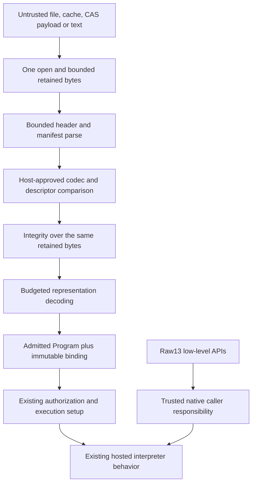

# Trust-boundary map — proposed admission, not an implemented guarantee

Every unsuccessful edge before A ends in admission failure, before VM creation,
state load, policy evaluation, model attachment or runtime-root setup. Reading the
input itself is necessary I/O; this is not a claim that admission has zero host
I/O. Diagnostic reporting may occur. Hashing and decoding retain one immutable
snapshot; retaining an FD alone is insufficient if its contents can change.
Do not hash then reopen, nor hash a mutable file and later parse changed bytes.

| Edge | Trusted at this point | Still untrusted / rule |
| --- | --- | --- |
| Caller → open | Host request, process permissions and explicit caller expectations | File path/extension, symlinks, mtime, CAS name, embedded declarations and producer strings do not establish semantics |
| Bytes → header | Fixed parser code and hard host caps | Verify lengths/overflow before reading declared bodies; parse only bounded canonical manifest with fixed keys; no payload parse/large allocation yet |
| Manifest → binding | Maintainer-approved local descriptor/build registry | Artifact-supplied ID/hash is a claim. Compare with approved local data; unknown codec/profile, incompatible build or conflict rejects |
| Binding → digest | Supported interpretation selected, not producer authenticated | Verify digest covers header/declarations/payload snapshot. A malicious producer can construct a matching digest; signatures/capabilities remain separate |
| Digest → Program | Byte identity and selected interpretation, not safety of nested lengths | Check all count arithmetic, enum representation, budgets and stream completion. No current unbounded deserialize call may bypass preflight/accounting |
| Program → execution | Valid admitted representation and binding | Existing policy, tier, runtime budgets, weights and caller authorization are still required; do not auto-allow based on admission |
| VM step | Existing interpreter call path | Keep current faults/semantics, including policy checks; admission neither adds nor suppresses traps and is not a correctness proof |

**Declaration sources:** initial scope is envelope + explicit host/caller expected
binding. Where CanonFS manifests/notes/CLI declarations exist, compare all shared
explicit fields; never override a contradiction. Do not implement new ELF/COFF note
systems or new CanonFS schemas just to satisfy the diagram. A missing declaration
is not a conflict, but missing required admission data still rejects. A checksum
provided by the same untrusted artifact is not an authorization credential.

**Source compilation:** compiler creates current typed Program under an explicit
approved target binding. It cannot use that authority to relabel an unknown loaded
artifact. External Base81 text is numeric input, not trusted compiler output;
semantic conversion needs a declared supported interpretation. Unknown-profile
inspection remains numeric/opaque and must not claim executable validation.

**Trusted native APIs:** preserving raw13 encode/decode and typed VM::load_program
means native callers remain inside the trusted computing base. They can bypass
file admission intentionally; no C++ sandbox guarantee is claimed. External input
adapters must not treat a cast/deserialized Program as that trust. Python/WASM
inspected paths compile source/pass typed Program; no new foreign raw execution
endpoint is proposed. Future adapters require their own boundary review.

**Model/CAS boundary:** opaque import/export or hashing is not execution admission.
Large external model loading has separate limits/authorization and must not be
squeezed into this Program-payload budget or treated as trusted by a CAS hash.
Project main.tisc cache reuse must re-admit; timestamp freshness does not suffice.

This map is source-informed design. Full CLI/VM admission, policies and side-effect
ordering under the proposal have not been executed or verified.
