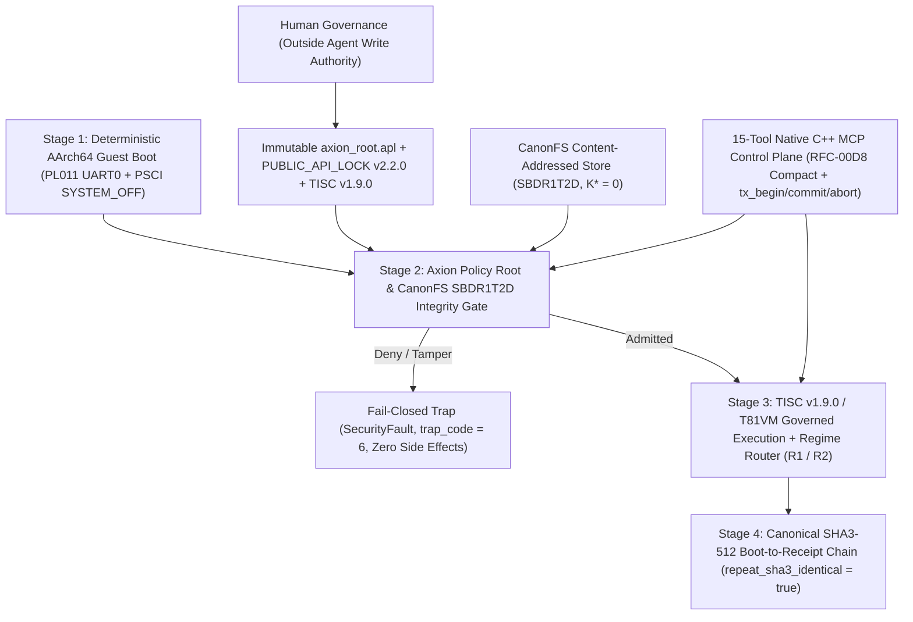

# "TernaryOS For AI, By AI" Architecture & Guardrails (v0.2 Draft)

**Status:** Draft architecture specification & verified control-plane/QEMU-contract baseline (minimal deterministic headless guest/enclave scope; does **not** claim general-purpose OS readiness or native x86-64 hardware timings).  
**Lineage:** Builds directly on [TERNARYOS_BOOT_TO_RECEIPT_CONTRACT_v0.1.md](./TERNARYOS_BOOT_TO_RECEIPT_CONTRACT_v0.1.md), [tests/qemu/test_boot_to_receipt_contract.py](../../../tests/qemu/test_boot_to_receipt_contract.py), and [T81_RESEARCH_STATUS_2026-11-23_BY_AI_FOR_AI_COEXISTENCE.md](../../ai-context/T81_RESEARCH_STATUS_2026-11-23_BY_AI_FOR_AI_COEXISTENCE.md).  
**Frozen Dependencies:** `docs/governance/PUBLIC_API_LOCK.json` (`v2.2.0`), frozen `TISC v1.9.0` (`209` opcodes), `Axion` fail-closed policy engine, `CanonFS` `SBDR1T2D` (`K* = 0`), and `RFC-00D8` native C++ MCP control plane.

---

## 1. Architectural Posture: Binary Coexistence, Not OS Replacement

`TernaryOS` is engineered strictly as a **minimal deterministic headless compute enclave** that coexists with conventional binary hosts (`Linux`, `macOS`, `Windows`). Binary hosts handle networking, orchestration, editors, storage drivers, and human governance; `TernaryOS` / `T81VM` handles policy-governed, content-addressed, bit-exact (`max_abs_err == 0`) ternary compute and cryptographic receipt emission.



---

## 2. Core Subsystems & Contracts

### 2.1 Deterministic Headless AArch64 Guest Boot & Serial Round-Trip
- **Guest Contract:** Fixed initial register/memory state, zero host wall-clock/RNG entropy in compute paths, deterministic PL011 UART0 (`0x09000000`) serial I/O, and clean PSCI `SYSTEM_OFF` (`0x84000008`, `hvc #0`).
- **Verified Real QEMU AArch64 Harness:** `tests/qemu/test_boot_to_receipt_contract.py` (`test_04_real_qemu_aarch64_serial_roundtrip_and_repeat_receipt`) boots a deterministic `480 B` bare-metal AArch64 ELF64 guest under real `qemu-system-aarch64 -machine virt -cpu cortex-a57 -nographic -monitor none -serial stdio` twice independently, exercising lock-step interactive round-trips:
  - `mutate-policy` → `AXION_DENY:POLICY_ROOT_IMMUTABLE`
  - `status` → `AXION_OK:status` → PSCI `SYSTEM_OFF` (`rc = 0`)
- **Pinned Real QEMU Digests (verified `repeat_sha3_identical == true` on Apple M2 macOS host):**
  - `boot_image_sha3_512`: `sha3-512:26bda4ae26a9fd74c4aff8e3c633c8b54174b9913742fd40d9228fe76a1eebfcc1717ac68824be3a1c9640a2aa2fc6803ed31667614254e439a3f93d83c0c55d`
  - `serial_transcript_sha3_512`: `sha3-512:b052306fc0fe3c1f6175e9d0241d6688b43cf877b9d0e99b25c8b32855e926b9fabccd06263a954c38379ea3c463d9336b1b5ff3eed1bb4d63c92198d0be9248`
- **Upstream Scope Boundary:** Full UEFI/EDK2 `BOOTAA64.EFI` + `boot_demo.sh` CI integration remains tracked in open PR `#856` (`.github/workflows/qemu-verification.yml`, `tests/qemu/test_boot_demo.py`).

### 2.2 Immutable `axion_root.apl` Policy Enforcement
- `axion_root.apl` defines tier floors (`(tier 1)`), `allowed-tensor-hashes`, and `enforcement-mode:fail-closed`.
- Any unauthorized model hash, missing Axion event reason, or attempt to execute unverified bytecode traps fail-closed **before** side effects (`verdict: VM_TRAP`, `trap_code: 6`, `trap_name: SecurityFault`).
- Any agent attempt to weaken `axion_root.apl` inside a transacted workspace (`t81.tx_begin` → tamper → `t81.tx_commit`) is rejected (`committed: false`), and `t81.tx_abort` restores exact original bytes.

### 2.3 `CanonFS` `SBDR1T2D` Content-Addressed Object Handling
- Pre-packed `SBDR1T2D` (`128`-trit block-sparse Dual-Rail) weight artifacts are imported via `t81 canonfs import` with `K* = 0` pre-packed amortization.
- Before execution, `t81.canonfs_fsck` (`ok == true`, `checked_objects >= 1`), `t81.determinism_hash`, and `t81.policy_test` (`admitted == true`) validate content identity and policy admission.
- Content identity (`SHA3-512`) establishes integrity only, **not** semantic truth or provenance authenticity.

### 2.4 `TISC v1.9.0` Execution & Evidence-Bounded `R1`/`R2` Regime Routing
- `T81VM` executes frozen `TISC v1.9.0` bytecode under Axion hooks (`t81.verify_subgraph` + `t81.run_subgraph`) with mandatory invariants:
  - `max_abs_err == 0` (bit-exact against oracle)
  - `dualrail_fallback_count == 0` (zero silent fallbacks on governed fast paths)
  - Explicit `dualrail_sparse128_blocks_skipped` telemetry reported in `DualRailTelemetry` and MCP responses.
- **Measured Apple M2 `R1`/`R2` Routing Policy (Ledger: `10` accepted / `16` negative constraints):**
  - **`R1` (`M == 1`, `s >= 90%`):** `CPU_1T_SBDR128_SIMD`
  - **`R1` (`s >= 75%` for `M >= 4`, or `75% <= s < 90%` at `M == 1`):** `GPU_R1_BitmaskSkip_Pop` (`H06-MEM-11`, `gpu_sparse_min_pct: 75`)
  - **`R1` (dense / moderate sparsity):** `GPU_R1_DualRail_Pop`
  - **`R2` (`int8` activations × ternary weights):** `CPU_4T_INT4W` (`M = 1..4`) / `CPU_4T_INT8W` (`M >= 16`)
- **Locked Negative Constraints (Fail-Closed):** `cpu_dualrail_unpack`, `2block_unroll_sbdr128`, `per_layer_cpu_thread_barrier`, and `gpu_csr_sbdr128_sparse` (`H06-MEM-10`) are permanently rejected by `routing_ledger.py` and `check_agent_synthesis_gate.py`.
- **Cross-Architecture Caveat:** `benchmarks/BM_DualRailMemoryBound.cpp` contains `#elif defined(__x86_64__) && defined(__AVX2__)` control kernels verified for syntax only (`X86_64_AVX2_SYNTAX_CHECK=OK`); native `x86_64` hardware timings require a native `x86_64` AVX2 host or CI runner and are not extrapolated from Apple Silicon `arm64`.

### 2.5 15-Tool Native C++ MCP Control Plane & Transacted Workspaces
All AI-agent orchestration routes through `./build/t81 mcp serve` (`RFC-00D8` compact JSON-RPC mode, `44.6%` payload reduction, `0.157 ms` p50 `gate_check`, `15/15` tools verified by `test_native_mcp.py`):

| Category | Native C++ MCP Tools |
| :--- | :--- |
| **Policy & Admission** | `t81.policy_validate`, `t81.policy_test`, `t81.get_effective_policy`, `t81.gate_check` |
| **Storage & Identity** | `t81.canonfs_fsck`, `t81.determinism_hash`, `t81.session_bootstrap` |
| **Transacted Workspaces** | `t81.tx_begin`, `t81.tx_commit`, `t81.tx_abort` |
| **VM Verification & Execution** | `t81.verify_subgraph`, `t81.run_subgraph` |
| **Diff, Memory & Adapters** | `t81.diff_check`, `t81.memory_search`, `t81.adapter_apply` |

### 2.6 Canonical `SHA3-512` Replay Receipts
Every governed boot-to-receipt execution emits a canonical chained digest:
```text
boot_receipt_sha3_512 = SHA3-512(
    boot_image_sha3_512 | [serial_transcript_sha3_512 |] policy_root_sha3_512 |
    canonfs_weight_sha3_512 | execution_receipt | route | k_star_prepacked=0
)
```
Control-plane `TERNARYOS-BOOT-RECEIPT-01` digest:
- `boot_receipt_sha3_512`: `sha3-512:737e6dc910757ff96e6a1207bf47ca9edc4f9f0f31ba46464463a003ac9405d7c95f0feb1d0c2147432ebc365a4f2c491c0ceba0d33b23706adad5b080e1aca7` (`repeat_sha3_identical: true`).

---

## 3. Strict AI-Authoring Guardrails

1. **Human-Only Write Authority (Hard Boundary):** Autonomous agents must never mutate `axion_root.apl` policy roots, relax or delete negative falsification constraints in `routing_ledger.py`, alter `docs/governance/PUBLIC_API_LOCK.json` (`v2.2.0`) or frozen `TISC v1.9.0`, bypass branch protection (`--admin`), or self-approve merges/releases.
2. **Fail-Closed Execution Invariants:** Governed execution paths require `max_abs_err == 0`, `dualrail_fallback_count == 0`, and `repeat_sha3_identical == true`. Any oracle mismatch (`SYNTH-ORACLE-ERR`), policy violation (`SecurityFault`), or silent fallback fails the synthesis gate.
3. **Evidence-Bounded Claims:** Separate implemented/tested behavior from draft proposals; preserve negative results; never substitute cross-compile syntax checks or emulation for native hardware timings.
4. **Required Local Verification Gates:**
   - `clang-format --dry-run --Werror` on touched C++ surfaces
   - `python3 scripts/ci/check_agent_synthesis_gate.py`
   - `python3 examples/research/agent-receipt-sidecar/routing_ledger.py`
   - `python3 examples/research/agent-receipt-sidecar/test_native_mcp.py`
   - `python3 -W error -m unittest -v tests/qemu/test_boot_to_receipt_contract.py`
   - 6-target CTest suite (`canonfs_policy_boundary_test`, `t81_vm_tensor_get_set_conformance_test`, `t81_vm_fault_test`, `canonfs_interchange_test`, `t81_dualrail_sbdr_vm_test`, `t81_determinism_codec_test`)
