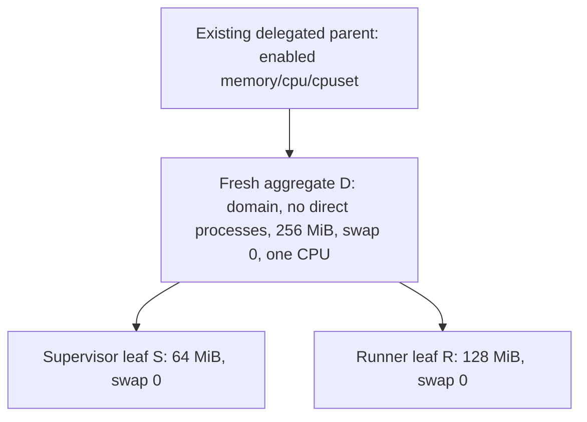

# LQ01-R1 supervisor implementation candidate

Historical initial candidate description below refers to b0ab7f31. The targeted
[authorization/import correction](AUTHORIZATION_IMPORT_CORRECTIONS.md) supersedes
its pathname handoff, final import policy and run.py-unchanged statements; the
run.py protected-file exception is now explicit. Other contracts remain intact.

Preparation only. No Linux qualification, probe, A–F execution, proof checking,
fixture execution, dependency installation, production integration or merge.
Codex authored this implementation and the earlier harness; these static checks
are not an independent implementation review or scientific proof.

Baseline: `2f2bc47ffc9441a060f3a1cfdf4ec893c6699d0e` (PR #808).
Protocol ancestor: `c5e0ca79c073a72bb41f03b76ddd68acbd7eab73` (PR #806).
Protocol SHA-256: `d48aeedc924cf505cab8a7fed316fc84d8f2c259dd502fd1d0a7fe8432f05de3`.
RFC candidate: `ec22a7588282d37ad027cff61c807bcf159ac2e0`.
The containing commit and identities.json identify this source; no future merge
commit or previously reviewed source identity is substituted for it.

## Implemented startup sequence

An external reviewed provisioner must create and limit this hierarchy before
starting the supervisor in S. The source never repairs controller settings or
moves the supervisor. Unknown subgroups, non-domain types, wrong ownership,
namespace mappings, limits, affinity, scheduler, or missing cgroup.kill block.
The outer manager must already cover the invocation; it is not a custom observer
allowed to escape the resource accounting.

Invoke the supervisor only with the reviewed interpreter's `-I -S -B` flags,
without optimization, and four explicit paths: `--authorization`,
`--qualification`, `--launch-record`, `--output`. This is a description of the
future interface, not permission to invoke it. No launch/authorization/qualification
receipt is fabricated in this change.

1. G0 checks D empty, S containing only self, R empty, directory-FD identities,
   domain/controller chain, D256/S64/R128 memory, zero swap, singleton effective
   cpusets and thread affinity, fair scheduling and D quota <= one CPU/burst0.
   It requires an unprivileged delegated owner and enables no-new-privileges and
   subreaping. Inherited CPU hard must be >=45 or unlimited. Prelude cumulative
   CPU must be <1 second. Fresh D accounting begins at zero before first launch.
2. Popen execs the stdlib-only bootstrap with `-I -S -B`, a new session, bounded
   READY/GO pipes and an inherited FD to R. There is no preexec callback.
   The parent then lowers its cumulative CPU soft/hard limits to2/3, before G1.
3. The stub validates parent PID/start identity, installs parent-death SIGKILL,
   lowers its inherited CPU limits to44/45 and enters R via the directory FD.
   It emits READY with its PID/start/PPID/PGID/SID, limits and R inode; it blocks
   for one <=256-byte GO packet and EOF. No experimental imports occur here.
4. G1 checks the exact pending stub identity/membership and kernel CPU limits,
   S2/3, topology, actual manager properties, Linux lock, schema-valid human
   records, current source/protocol/corpus/host/dependency identities and clean
   Git tree. Only then is the artifact directory created and GO released.
   The stub rechecks the authorization digest and parent before final exec of
   the unchanged run.py with its existing import semantics and hash seed0.

G0 necessarily precedes the fork with inherited hard>=45; this does not claim
kernel hard3 from the first instruction. All startup costs remain charged to D
and covered by the pre-existing manager. A requirement for hard3 from instruction
one would need a separately reviewed independent manager launch design.

## Launch record and outer manager prerequisite

A separate bounded supporting launch record (not an evidence-schema amendment)
requires exactly these keys:

- `aggregate_path`: canonical absolute D path, matching the qualification receipt.
- `aggregate_inode`: D inode from the fresh provisioner.
- `cpu_origin_usec`: exactly0, established before any custom process enters D.
- `started_monotonic_ns`: same-time-namespace origin before first custom launch.
- `boot_id`, `invocation_id`: current boot and systemd INVOCATION_ID.
- `manager_unit`: actual .service unit, and `manager_scope`: system or user.

The record is a trusted operator/provisioner attestation, not authenticated by
JSON or by inode comparison. Freshness and the earliest accounting/time origin
need independent qualification evidence. The gate reads systemctl properties:
Type=exec, active, no restarts, KillMode=control-group, SendSIGKILL=yes, no hooks,
no notify extensions, RuntimeMax<=55s, randomized extra=0, activation/stop<=1s.
Manager timers remain subject to host delivery/cleanup qualification; these
values alone do not prove a60s bound. User-manager discovery uses only the
canonical /run/user/UID runtime path. Unsupported managers/duration encodings
or properties block; no fallback or privilege escalation is attempted.

## Accounting, cleanup and evidence

No post-gate CPU subtraction/reset hides startup work: D's absolute usage is
checked against48s and reported against the unchanged50s whole-suite ceiling.
The inner whole-invocation wall guard remains58s and total ceiling60s; area
walls remain5s for A/B and10s for C–F. All helpers remain in S/D; metadata helpers, including static verification, have
bounded output and a2s wall guard while the parent polls whole-D accounting.
After cleanup, supporting-evidence finalization uses49s CPU/59s wall guards,
leaving the original50s/60s ceilings as outer margins. No quota
is interpreted as a cumulative CPU allowance. Tighter ancestor constraints may
cause earlier inconclusive stops and never grant larger allowances.

On failure/exit GO closes, the verified owned process group is killed when safe,
the direct child is terminated, and R/cgroup.kill catches descendants with new
sessions. A bounded subreaper loop requires the direct child reaped, no adopted
children and empty/unpopulated R. Failure or lost identity remains incomplete;
the outer manager must terminate the entire D if S dies or cleanup fails. The
supervisor never writes D/cgroup.kill. No population scan outside the owned tree
is substituted for this requirement.

Supporting evidence uses exclusive bounded writes; successful earlier artifacts
are preserved when later writes fail. Capacity is reserved before supporting
writes, artifacts are inventoried without an unbounded directory list, and no
metadata is invented after capacity/time/process death. A record's finalization
remains `unverified_until_external_inventory`; an independent observer must
verify the completed hash inventory and terminal evidence. A schema-valid summary
with any INCONCLUSIVE_LIMIT/BLOCKED/INVALID_RUN area cannot mark completion.
COMPLETED_UNVERIFIED describes process completion, never a contract pass or host
qualification. The original stop reason and cleanup observations remain separate.

## Preserved identities and unresolved qualification work

All A–F model/domain/accounting/proof source,24 facts, F00–F07/four rotations,
F32+78+144=254/256, both evidence schemas, F288-v1 deferred obligation, dependency
lock, protocol and governance holds remain byte-identical to baseline. The full
suite remains49,408 states,60s wall,50s CPU,256MiB aggregate and25MiB artifacts.
No experimental state charges are assigned to this preparation-only metadata.
Both proof implementations still share substring/regex extraction of pinned
RFC §4.1; explicit human source-passage/normative review remains mandatory.

Remaining blockers include independently reviewed Linux interpreter/wheel/file
re-lock; real delegated ownership/controller configuration; start-origin evidence;
manager and cgroup.kill behavior; RLIMIT/GO/EOF/parent-death failure paths;
cleanup of changed-session descendants; peak-memory and deadline overshoot;
artifact persistence and actual resource fit. The final runner's unchanged site
import policy needs interpreter-path/startup-hook qualification, including base
interpreter paths. The gate rejects discovered hooks; no host safety claim follows.
Linux x86_64 and ARM64 are both unqualified. macOS/Windows execution is unsupported.
A privileged/malicious host or operator is outside the attested trust boundary.

This branch is stacked on the actual PR #808 branch. Review this delta separately;
do not merge #806/#807/#808 here or predict their integration commit identities.
Any later integration/re-lock creates a new source SHA requiring renewed static
checks, independent review and qualification pinning. Qualification authorization
and one-run A–F execution authorization remain separate future human decisions.
