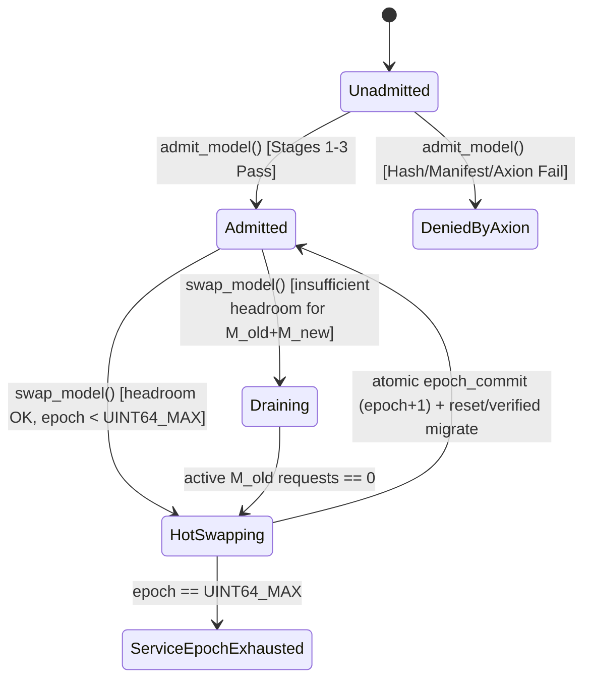
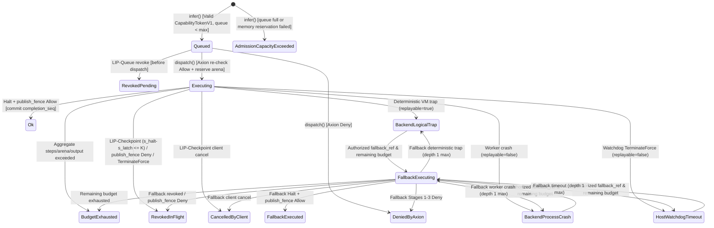

# RFC-00D7: T81 Model Service Boundary (`t81.model-service.v3-draft`)

- **RFC-ID:** RFC-00D7
- **Title:** T81 Model Service Boundary (`t81.model-service.v3-draft`)
- **Status:** draft
- **Type:** standards-track
- **Applies-To:** hosted AI runtime boundary, `Axion` capability governance, `CanonFS` trace/manifest verification, future `Axion OS` (`KAQR`) transport seam
- **Created:** 2026-11-15
- **Updated:** 2026-11-15
- **Discussion:** Independent Architecture Reconciliation (Phase 3 — R3 + Codex Review Corrections)

> [!CAUTION]
> **DRAFT / NON-NORMATIVE / NOT IMPLEMENTED**
>
> This document is an unratified draft specification prepared for independent review. It does **not** modify the frozen TISC ISA (`include/t81/isa/opcodes.hpp`, `spec/tisc-spec.md`), authorize ABI implementation, promote any experimental surface, or grant merge/release authority.

---

## 1. Existing Implemented Baseline vs. Proposed Service ABI

This RFC strictly separates **verified existing repository functionality** (`main` at `40695b0ba`) from **proposed unimplemented interfaces**:

| Surface | Status on `main` (`40695b0ba`) | Source Anchors |
|---|---|---|
| **T81VM single-opcode AI adapter** | **Implemented (bounded)** — runs synthetic `[<opcode>, Halt]` TISC programs; external `llama.cpp`/`onnxruntime` stubs deleted | `include/t81/vm/ai_backend/backend_adapter.hpp`, `vm/ai_backend/backend_adapter.cpp` |
| **Axion `TLoadHash` policy gate & AI hooks** | **Implemented (in-process whitelist)** — checks `SyscallContext{Opcode::TLoadHash, payload=hash, caller}` against `PolicyEngine`; does **not** verify raw model bytes or parse `RFC-00D3` JSON | `kernel/axion/ai_model_loader.cpp`, `kernel/axion/ai_hooks.cpp`, `vm/vm.cpp` |
| **CanonFS block-backed metadata auth** | **Implemented (tested)** — `publish_capability`, `revoke_capability`, `parity_repair_subtree` consult `axion_allow`; does **not** yet expose pre-allocated fixed-size emergency journal `fsync` rings | `fs/block_backed_driver.cpp` |
| **Model manifest schema (`RFC-00D3`)** | **Draft schema** — JSON schema exists for model manifests and diff/import results | `spec/rfcs/RFC-00D3-model-manifest-schema.json` |
| **Batch inference engine** | **Unbuilt / non-deterministic** — uses `std::mutex`, `std::condition_variable`, `<random>`; not compiled in `CMakeLists.txt` | `inference/batch_inference_engine.cpp` |
| **`t81.model-service.v3-draft` (`IModelService`, `IWorkerSupervisor`, `CapabilityTokenV1`, emergency journal, JCS trace verifier)** | **PROPOSED / NOT IMPLEMENTED** — defined solely by this draft RFC; depends on unimplemented IPC, sandbox, and `CanonFS` durability extensions | This document (`RFC-00D7`) |
| **Axion OS `KAQR` / EL0 transport** | **Proposed / Future Phase B** — `ternaryos/` links `t81_core + t81_axion` (not `t81_vm`); `cpa004_evaluator` is off-`main` | `ternaryos/kernel/kernel_service_contract.hpp`, `ternaryos/ipc/canon_message.hpp` |

---

## 2. Logical Determinism vs. Physical Execution-Time Guarantees

This RFC strictly separates **logical determinism** (normative when no asynchronous host failure occurs) from **physical execution-time behavior** (non-normative, host-dependent):

1. **Independent Cross-Host Determinism (Zero Async External Events):** Given identical `(InferenceRequestV1, ModelRef, PolicyRef, epoch_id, seed)` and an admitted deterministic backend (`RFC-0042` equivalence) with **no** injected external revocations, client cancellations, or physical host timeouts, compliant hosts (`linux-x86_64`, `linux-arm64`, `macos-arm64`, `windows-x86_64`) **MUST** independently produce bit-identical `ServiceStatus`, `Trap`, `output_tensor_digest`, `consumed_budget`, and per-request `trace_canon_hash81`.
2. **Recorded-Event Replay:**
   - *Single-Request Logical Replay:* Re-executes one request together with any recorded `LIP` coordinates from `t81.model-service-trace.v1`, verifying identical `trace_canon_hash81`.
   - *Session Commit-Log Replay:* Re-executes the separate `t81.model-service-session-log.v1` in `commit_seq` order, verifying identical admission/dispatch/revocation verdict sequence.
3. **Physical Execution-Time (Explicitly Unclaimed):** Wall-clock latency, OS scheduling jitter, and asynchronous physical failures (`HostWatchdogTimeout`, `BackendProcessCrash`) depend on the untrusted host OS hypervisor. **Universal cross-host bit-identity is explicitly prohibited for asynchronous host failures**, which **MUST** carry `replayable: false`.

---

## 3. Canonical Envelopes, Field Bounds & Outcome Taxonomy

### 3.1 Field Types, Ordering Rules & Limits

| Field / Parameter | Type & Representation | Bounds / Rules |
|---|---|---|
| `schema_version` | ASCII string | Exact `"t81.model-service.v1"` |
| `request_id` | `uint64_t` (decimal string in JCS) | Caller-unique per session (`>= 1`) |
| `capability_id` | `uint64_t` (decimal string in JCS) | Service-assigned monotonic ID (`>= 1`) |
| `epoch_id` | `uint64_t` (decimal string in JCS) | Monotonic (`1 <= epoch_id < UINT64_MAX`; `0` invalid) |
| `generation` | `uint64_t` (decimal string in JCS) | Monotonic per `(capability_id, service_boot_generation)` |
| `caller_id` | UTF-8 `PolicySubject` string | Non-empty, `1..256` bytes |
| `shape_descriptor` | Canonical shape/dtype object | `{ dtype: "trit2"|"int64"|"t81float", dims: uint64[1..8] }` |
| `seed` | `uint64_t` (decimal string in JCS) | `0` = deterministic greedy |
| `checkpoint_interval_k` ($K$) | `uint32_t` | `1 <= K <= 4096`, default `K = 256` |
| `max_queued_requests` | `uint32_t` | Configurable `>= 1`, default `1024` |
| `max_wall_ms` | `uint64_t` | `>= 1`; supervisory watchdog only (never in trace hash) |
| `N_max` (emergency slots) | `uint32_t` | Fixed at startup (`>= max_active_workers + max_queued_requests`) |

### 3.2 Versioned Request & Response Envelopes (`t81.model-service.v1`)

- **`CapabilityTokenV1`:** `{ capability_id, epoch_id, generation, service_boot_generation, caller_id, min_tier: TierId, policy_canon_hash81, auth_mac }` *(unimplemented; `auth_mac` requires host-provisioned key management)*.
- **`InferenceRequestV1`:** `{ schema_version, request_id, capability_token: CapabilityTokenV1, model_ref: { model_canon_hash81, manifest_canon_hash81 }, input_tensor_digest: { digest: CanonHash81, shape_descriptor }, budget: { max_logical_steps, max_arena_bytes, max_output_bytes, evidence_reserve_steps, evidence_reserve_bytes, max_wall_ms }, seed, fallback_ref?: { model_ref, policy_ref } }`.
- **`InferenceResponseV1`:** `{ schema_version, request_id, dispatch_seq, completion_seq, status: ServiceStatus, vm_trap: Trap, error_origin: ErrorOrigin, replayable: bool, emergency_record_used: bool, output_tensor_digest?, consumed_budget: { primary_steps, migration_steps, fallback_steps, evidence_steps, peak_arena_bytes, output_bytes, trace_bytes }, trace_canon_hash81 }`.

### 3.3 Exhaustive 1-to-1 Terminal Outcome Taxonomy

| `ServiceStatus` | `Trap` | `ErrorOrigin` | `Replayable` | Fallback Allowed? |
|---|---|---|---|---|
| `Ok` | `None` | `None` | `true` | N/A |
| `DeniedByAxion` | `SecurityFault` | `AxionGate` | `true` | **No** |
| `RevokedPending` | `SecurityFault` | `AxionGate` | `true` | **No** |
| `RevokedInFlight` | `SecurityFault` | `AxionGate` | `true` (`T81VM`) / `false` (native `TerminateForce`) | **No** |
| `CancelledByClient` | `None` | `Client` | `true` (at committed `LIP`) | **No** |
| `AdmissionCapacityExceeded` | `BoundsFault` | `HostSupervisor` | `true` | **No** |
| `BudgetExhausted` | `TierFault` / `BoundsFault` | `LogicalVM` | `true` | **No** |
| `BackendLogicalTrap` | `DecodeFault` / `BoundsFault` / `TypeFault` | `LogicalVM` | `true` | **Yes** (depth $\le 1$) |
| `BackendProcessCrash` | `None` | `NativeBackendWorker` | `false` | **Yes** (depth $\le 1$) |
| `HostWatchdogTimeout` | `None` | `HostSupervisor` | `false` | **Yes** (depth $\le 1$) |
| `ServiceEpochExhausted` | `SecurityFault` | `HostSupervisor` | `true` | **No** |
| `FallbackExecuted` | `None` | `None` | `true` (iff primary failure was deterministic) | N/A (depth 1 reached) |

*Exhaustive Fallback Rule:* Fallback depth is strictly **1**. If `FallbackExecuting` terminates via `Ok`, the request returns `FallbackExecuted`. If `FallbackExecuting` hits **any** failure (`DeniedByAxion`, `RevokedInFlight`, `CancelledByClient`, `BudgetExhausted`, `BackendLogicalTrap`, `BackendProcessCrash`, `HostWatchdogTimeout`), the request **MUST NOT** trigger a second fallback and **MUST** terminate immediately with that fallback failure's exact `ServiceStatus`, `Trap`, and `ErrorOrigin`.

---

## 4. Normative Technical Specification (R3 Corrected)

### 4.1 Three-Stage Model Admission & Axion Authorization
`admit_model(ModelRef, Policy)` separates storage integrity, manifest binding, and policy evaluation:
1. **Stage 1 — Model-Byte Verification (`CanonFS`, proposed adapter over `CanonHash81`):** Verify raw weight artifact bytes match `model_ref.model_canon_hash81`.
2. **Stage 2 — Manifest Binding (`RFC-00D3`, proposed validator):** Verify manifest bytes match `model_ref.manifest_canon_hash81`, conform to `spec/rfcs/RFC-00D3-model-manifest-schema.json`, and assert `manifest.model_canon_hash81 == model_ref.model_canon_hash81` and valid `state_schema_hash81`.
3. **Stage 3 — Axion Policy Authorization (existing `load_model_via_tloadhash` + `PolicyEngine`):** Authorize `(model_canon_hash81, manifest_canon_hash81, caller_id, min_tier)` **only after** Stages 1–2 succeed.

`Axion` evaluates `CapabilityTokenV1` and `SyscallContext` both at `enqueue` and immediately prior to `dispatch`. Fallback (`fallback_ref`) is permitted **only** on `BackendLogicalTrap`, `BackendProcessCrash`, or `HostWatchdogTimeout` and requires independent Stages 1–3 verification under the caller's remaining budget.

### 4.2 Capability Binding, Selective Revocation & Restart Behavior
- **Authenticated Binding:** `CapabilityTokenV1` binds `(capability_id, epoch_id, generation, service_boot_generation, caller_id, min_tier, policy_canon_hash81)` via `auth_mac` (HMAC/signature; unimplemented, requires host key management). Unsigned or mismatched tokens fail closed with `DeniedByAxion`.
- **Selective vs. Epoch Revocation:**
  - `revoke_epoch(e)` sets `revoked_watermark_epoch = max(revoked_watermark_epoch, e)`. Any token with `epoch_id <= revoked_watermark_epoch` is invalid.
  - `revoke_capability(capability_id)` inserts `capability_id` into a persistent `revoked_capability_ids` set without revoking peer capabilities in the same epoch. Entries with `epoch_id <= revoked_watermark_epoch` may be compacted.
- **Restart Behavior:** On startup, `service_boot_generation` increments monotonically (persisted in `CanonFS`), and `revoked_watermark_epoch` + active `revoked_capability_ids` are reloaded **before** `admit_model` or `infer` accepts traffic. Tokens from prior `service_boot_generation` values fail closed unless explicitly marked cross-boot persistent by `Axion` policy.

### 4.3 Event Ordering, Revocation Linearization & Output-Publication Fencing
- **Dispatch & Non-Blocking Completion:** `admit_model`, `infer`, `cancel`, `revoke_*`, and `swap_model` receive monotonic `dispatch_seq` (with Rule O1 revocation precedence and Rule O2 `(priority, request_id)` dispatch order). Each request commits its terminal state independently upon completion (`completion_seq`), returning `InferenceResponseV1` without head-of-line blocking behind stalled peers.
- **Output-Publication Fence (Linearization Point):** Before any request transitions to `Ok` or `FallbackExecuted` and publishes `output_tensor_digest`, it **MUST** acquire the atomic publication fence and verify `!is_revoked(epoch_id, capability_id)` at `publish_seq`. If a `revoke_*` committed prior to `publish_seq`, output publication **MUST** abort, discard uncommitted outputs, zero the arena, and return `RevokedInFlight` (`SecurityFault`).
- **Logical Injection Points (`LIP`) & $K$-Step Bound:**
  1. `LIP-Queue(dispatch_seq)`: Prior to dispatch -> `RevokedPending` / `CancelledByClient`.
  2. `LIP-Checkpoint(logical_step, opcode_pc)`: Polled inside `T81VM` every $K$ steps ($1 \le K \le 4096$, default `256`) and prior to `TWMATMUL`, `TATTN`, `QMATMUL`, `ATTN`, `WLOAD`, `TLoadHash`. The first poll after revocation commit latches `s_latch = current_vm_logical_step`, and `T81VM` **MUST** halt at `s_halt` with $0 \le s_{\text{halt}} - s_{\text{latch}} \le K$.
  3. `LIP-IPC(ipc_chunk_seq)`: Polled at bounded native-worker IPC boundaries; opaque native workers lack VM step counters and enforce revocation via withheld IPC + immediate `TerminateForce` (`replayable: false` if killed mid-chunk).

### 4.4 Canonical Trace Serialization (`t81.model-service-trace.v1`), Event Schema & Test Vectors
- **Canonical Encoding:** RFC 8785 (JCS), **except** all 64-bit integers (`uint64_t`/`int64_t`) **MUST** be serialized as canonical base-10 ASCII strings without leading zeros (avoiding IEEE-754 `2^53 - 1` precision loss).
- **Event Object Schema (`events[*]`):** `{ "seq_no": "<1..m>", "kind": "AdmitAllow|AdmitDeny|Dispatch|LIPInject|Checkpoint|Trap|PublishFence|Terminal", "logical_step": "<uint64>", "lip_kind"?: "LIP-Queue|LIP-Checkpoint|LIP-IPC", "opcode_pc"?: "<uint64>", "s_latch"?: "<uint64>", "s_halt"?: "<uint64>", "detail": "<string>" }`.
- **Domain Separation & Digest Rules:**
  - Trace digest prefix: `"t81:ms:trace:v1:" || jcs_bytes`.
  - Emergency digest prefix: `"t81:ms:emergency:v1:" || emergency_bytes[0..479]`.
  - **Excluded from per-request `trace_canon_hash81`:** `integrity_digest_canon_hash81` itself and `non_deterministic_host_telemetry` (`completion_seq`, `dispatch_seq`, `host_wall_ms`, `worker_pid`, `os_signal`, `host_arch`).
  - **Included:** All normative trace fields, `events[*]` (using request-local `1..m` `seq_no`), `logical_counters`, `terminal`, and `extensions`. Unknown top-level keys fail verification closed.
- **Session Commit Log (`t81.model-service-session-log.v1`):** Separate append-only log recording `{ commit_seq, event_kind, request_id, epoch_id, s_latch? }` for session replay.
- **Canonical JCS Test Vector (for C++/Python verifier alignment):**
  - Normative JCS payload excerpt with `seed = UINT64_MAX` (`18446744073709551615`) and `epoch_id = 7`:
    `{"epoch_id":"7","request_id":"42","seed":"18446744073709551615","trace_schema":"t81.model-service-trace.v1"}`
  - Hash input = ASCII bytes `"t81:ms:trace:v1:"` concatenated with the UTF-8 JCS bytes above (with `non_deterministic_host_telemetry` and `integrity_digest_canon_hash81` stripped).

### 4.5 Aggregate Memory, Admission Reservation & Emergency Journal (`CanonFS` Proposed)
- **Usable Service Memory:** `usable_bytes = service_max_bytes - (N_max * 512)`.
- **Admission & Dispatch Reservation:** `infer()` admits up to `max_queued_requests`; if full, fails closed with `AdmissionCapacityExceeded`. Before transitioning `Queued -> Executing`, the scheduler **MUST** reserve `req.budget.max_arena_bytes + fallback_staging_overhead` within `usable_bytes` (alongside `mem_active_models + mem_swap_staging + mem_migration`); if insufficient, fails closed with `AdmissionCapacityExceeded` (never overcommitting active RAM).
- **Fixed 512-Byte Emergency Failure-Record Layout (`t81.emergency-fail.v1`):**

| Offset | Size | Field | Description |
|---|---|---|---|
| `0` | `8` | `magic` | ASCII `"T81EFv1\0"` |
| `8` | `2` | `version` | `1` (little-endian `uint16_t`) |
| `10` | `2` | `flags` | Bit `0`: `durable_persisted`; Bit `1`: `truncated` |
| `12` | `4` | `reserved` | Zero (`0`) |
| `16` | `8` | `request_id` | `uint64_t` LE |
| `24` | `8` | `epoch_id` | `uint64_t` LE |
| `32` | `8` | `generation` | `uint64_t` LE |
| `40` | `8` | `last_logical_step` | `uint64_t` LE |
| `48` | `1` | `status` | `ServiceStatus` enum byte |
| `49` | `1` | `vm_trap` | `Trap` enum byte |
| `50` | `1` | `error_origin` | `ErrorOrigin` enum byte |
| `51` | `5` | `pad` | Zero (`0`) |
| `56` | `424` | `reason_utf8` | NUL-padded UTF-8 diagnostic summary |
| `480` | `32` | `canon_hash81` | `CanonHash81("t81:ms:emergency:v1:" \|\| bytes[0..479])` |

- **Durability & Startup Recovery Protocol:** Pre-allocated in-memory slots guarantee zero-heap-allocation OOM reporting (`durable_persisted = 0`). Where a pre-opened, pre-allocated fixed-size emergency journal on `CanonFS` (*proposed extension to `fs/block_backed_driver.cpp`*) is configured, the supervisor writes and `fsync`s the 512-byte slot best-effort (`durable_persisted = 1` only after `fsync` returns `0`). On restart, the supervisor scans all `N_max` slots, verifies `magic` + `canon_hash81` over `[0..479]`, discards/logs torn slots (`torn_emergency_slots_detected`), and archives valid failure records into `CanonFS`.

### 4.6 Platform-Specific Native Worker Supervision & Sandbox Gates (`PROPOSED`)
`IWorkerSupervisor` (`{ Spawn, PollIPC, CancelGraceful, TerminateForce, Reap }`) is **not yet implemented**. Production qualification of untrusted native workers requires OS-level containment beyond process spawning:

| Platform | Required Containment & Syscall/Resource Gate | Known Platform Caveat |
|---|---|---|
| **Linux** | Non-root UID/GID, `PR_SET_NO_NEW_PRIVS`, `PR_SET_PDEATHSIG(SIGKILL)`, `seccomp-bpf` allowlist (only IPC pipe/SHM `read`/`write`, `mmap` anon, `brk`, `exit_group`; deny `fork`/`clone`/`exec`, all sockets, FS `open*`, `ptrace`), `cgroup v2`/`RLIMIT_AS`, `pidfd` reap | Kernel exploits remain outside in-process `Axion` scope |
| **macOS** | Unprivileged role + Seatbelt profile / hardened sandbox denying network, `fork`/`exec`, `ptrace`, and FS writes outside pinned `CanonFS` read-only FDs, `setrlimit`, `kqueue` reap | `sandbox_init` is Apple-deprecated; production lane may require signed helper entitlements |
| **Windows** | `AppContainer` or Restricted Token, `Job Object` (`KILL_ON_JOB_CLOSE`, `JOB_OBJECT_LIMIT_PROCESS_MEMORY`, `ACTIVE_PROCESS=1`, **`JOB_OBJECT_LIMIT_BREAKAWAY_OK` MUST NOT be set**), `PROC_THREAD_ATTRIBUTE_HANDLE_LIST` | Handle-inheritance leakage must be audited per `CreateProcessW` call |

- **Hosted First, Axion OS Seam:** Hosted `t81_vm + t81_axion + t81_core` ships first; future `Axion OS` serializes `InferenceRequestV1`/`ResponseV1` over `KAQR` (`ternaryos/kernel/kernel_service_contract.hpp`, `ternaryos/ipc/canon_message.hpp`) with EL0 `TTBR0_EL1` isolation.

---

## 5. R1-to-R3 + Review Correction History

| Stage | Summary of Changes |
|---|---|
| **R1 → R2** | Separated `ReplayableLogical` vs. `NonReplayablePhysicalAbort`; prohibited cross-host bit-identity claims for async timeouts; separated process vs. VM isolation; added aggregate budget accounting, $K$-step checkpoints, and 1-to-1 taxonomy. |
| **R2 → R3** | Split recorded-log replay vs. cross-host determinism; decoupled `completion_seq` from `dispatch_seq` (no HoL blocking); added `LIP` points, JCS exclusions, `service_max_bytes` + 512B emergency slab, and cross-OS `IWorkerSupervisor`. |
| **R3 → Codex Review Corrections** | Added output-publication revocation fence (`publish_fence`); split per-request trace vs. `t81.model-service-session-log.v1`; added `CapabilityTokenV1` `auth_mac` + selective revocation + `service_boot_generation`; separated 3-stage `CanonFS`/`RFC-00D3`/`TLoadHash` admission; split Model vs. Request state machines + exhaustive fallback outcomes; added `AdmissionCapacityExceeded` + `usable_bytes` reservation; pinned exact 512-byte emergency binary layout + torn-slot recovery; detailed OS sandbox allowlists/caveats + JCS test vector. |

---

## 6. Threat Model (`TM-01`–`TM-13`)

| ID | Threat Vector | Mitigation |
|---|---|---|
| **TM-01** | Unverified / tampered weights or manifest | 3-stage `CanonHash81` weight + `RFC-00D3` manifest binding + `load_model_via_tloadhash` (§4.1). |
| **TM-02** | TOCTOU / post-revocation output leak | Dual `Axion` gate + `LIP-Checkpoint` + atomic `publish_fence` before `Ok` (§4.1, §4.3). |
| **TM-03** | Fallback policy laundering | Depth-1 cap; forbidden on `DeniedByAxion`/`Revoked*`/`BudgetExhausted`/`AdmissionCapacityExceeded`; independent Stages 1–3 gate (§3.3, §4.1). |
| **TM-04** | Stale / forged capability or handle | `CapabilityTokenV1` `auth_mac` + `(epoch_id, generation, service_boot_generation)`; `CanonHash81` digests across boundary (§3.2, §4.2). |
| **TM-05** | Loop / OOM DoS | `max_logical_steps` + `usable_bytes` admission reservation + watchdog `TerminateForce` (§4.5, §4.6). |
| **TM-06** | Epoch wraparound replay | Strict `UINT64_MAX` fail-closed `ServiceEpochExhausted` freeze (§3.1, §4.6). |
| **TM-07** | Nondeterminism injection | Zero `<chrono>`/`<random>` in deterministic paths; explicit `seed`; `(priority, request_id)` dispatch (§2, §4.3). |
| **TM-08** | `dispatch`/`revoke`/`cancel` race | Total `dispatch_seq` serialization + Rule O1 + `publish_fence` (§4.3). |
| **TM-09** | Restart revocation erasure | `fsync`-sealed `revoked_watermark_epoch`, `revoked_capability_ids`, and `service_boot_generation` reloaded before traffic (§4.2). |
| **TM-10** | Aggregate budget laundering | Single non-replenishable budget with pre-reserved evidence allocation (§3.2). |
| **TM-11** | Head-of-line starvation | Independent `completion_seq` commit + per-worker `max_wall_ms` `TerminateForce` (§4.3). |
| **TM-12** | Telemetry / extension tampering | `non_deterministic_host_telemetry` excluded; `extensions` and domain tags hashed; unknown keys fail closed (§4.4). |
| **TM-13** | Swap OOM / torn emergency record | `usable_bytes` reservation + pre-allocated 512B slab with `canon_hash81` torn-slot recovery (§4.5). |

---

## 7. State Machines (Model-Slot & Per-Request)

### 7.1 Model-Slot Lifecycle

### 7.2 Per-Request Lifecycle

---

## 8. Acceptance-Test Matrix (`AT-MS-01`–`AT-MS-25`)

| Test ID | Target Property | Stimulus | Expected Normative Outcome |
|---|---|---|---|
| **AT-MS-01** | 3-stage admission | (a) Altered 1B weight; (b) `manifest.model_canon_hash81` mismatch; (c) Axion policy deny | All 3 fail closed before worker spawn (`AdmitResult.ok=false`, `DeniedByAxion`). |
| **AT-MS-02** | Cross-host determinism | Identical `InferenceRequestV1` (`seed=42`, no async events) on Linux/macOS/Windows | Bit-identical `output_tensor_digest`, `consumed_budget`, `trace_canon_hash81`. |
| **AT-MS-03** | Step & arena caps | `max_logical_steps=10` on 100-step task; tight `max_arena_bytes` | Fails closed with `BudgetExhausted`; arena zeroed; trace sealed. |
| **AT-MS-04** | Pending & selective revocation | Issue `cap_1`, `cap_2` at `epoch=5`; `revoke_capability(cap_1)` before dispatch | `cap_1` -> `RevokedPending` (`LIP-Queue`); `cap_2` executes `Ok`. |
| **AT-MS-05** | In-flight & `publish_fence` | Trigger `revoke_epoch(5)` (a) mid-run, (b) right as `Halt` enters `publish_fence` | Both return `RevokedInFlight` (`SecurityFault`); zero output leaked. |
| **AT-MS-06** | Hot-swap reset vs. migrate | `swap_model` with (a) incompatible schema, (b) compatible `state_schema_hash81` + `Allow` | (a) Clean reset; (b) Deterministic migration verified; `epoch` -> `k+1`. |
| **AT-MS-07** | Backend crash & hang | Inject `SIGSEGV` and `while(1)` in isolated backend worker | Supervisor stays alive; `BackendProcessCrash` / `HostWatchdogTimeout`. |
| **AT-MS-08** | Exhaustive depth-1 fallback | (a) Primary crashes -> fallback `Ok`; (b) Primary crashes -> fallback crashes; (c) `DeniedByAxion` | (a) `FallbackExecuted`; (b) `BackendProcessCrash` (no 2nd fallback); (c) `DeniedByAxion`. |
| **AT-MS-09** | Epoch overflow, forged token & stale handle | Swap at `UINT64_MAX`; forged `auth_mac`; stale `service_boot_generation` | Swap -> `ServiceEpochExhausted`; forged/stale tokens -> `DeniedByAxion` / `RevokedPending`. |
| **AT-MS-10** | Axion OS `KAQR` parity | Serialize `InferenceRequestV1`/`ResponseV1` over `KAQR` (`canon_message.hpp`) | Round-trip byte/digest identity with hosted envelope. |
| **AT-MS-11** | Async non-replayability | Trigger `HostWatchdogTimeout` on two hosts | Traces marked `replayable: false`, `ErrorOrigin::HostSupervisor`. |
| **AT-MS-12** | Session log replay | 1,000 concurrent `infer`/`cancel`/`revoke_epoch`; replay `t81.model-service-session-log.v1` | Replayed `commit_seq` order yields identical verdict sequence. |
| **AT-MS-13** | Checkpoint interval $K$ | $K=256$; inject `revoke_epoch` at step $100$ of $10{,}000$-step VM task | Halts within $\le 256$ steps (`RevokedInFlight`, `SecurityFault`). |
| **AT-MS-14** | Aggregate budget | `max_logical_steps=500`, `evidence_reserve=50`; primary fails at 420 -> fallback needs 100 | Fallback stops at `BudgetExhausted` (450); reserve seals trace within 500. |
| **AT-MS-15** | Durable revocation & restart | `revoke_epoch(7)` + `revoke_capability(99)`, kill/restart supervisor, submit `epoch=7` & `cap=99` | Reloads `revoked_watermark_epoch=7`, `revoked_capability_ids`, increments `service_boot_generation`; rejects both. |
| **AT-MS-16** | HoL unblocking | Dispatch slow `req_1` (`while(1)`) then fast `req_2` (`Ok`) | `req_2` commits `completion_seq` and returns `Ok` immediately. |
| **AT-MS-17** | `LIP` recording & replay | Inject async `revoke_epoch`; replay captured trace 100x with host jitter | All 100 replays halt at identical `(LIP-Checkpoint, s_latch, s_halt)` and `trace_canon_hash81`. |
| **AT-MS-18** | Digest exclusion & JCS vector | Validate canonical vector (§4.4); mutate `host_wall_ms`; mutate `extensions`; add unknown key | `host_wall_ms` mutation passes; `extensions`/unknown key fail closed. |
| **AT-MS-19** | Admission reservation & torn recovery | Exceed `max_queued_requests`/`usable_bytes`; crash mid-512B emergency write + valid write | Over-capacity -> `AdmissionCapacityExceeded`; startup ignores torn slot, recovers valid `canon_hash81` slot. |
| **AT-MS-20** | Cross-OS worker reap | Hostile worker spawning child + `while(1)` on Linux, macOS, Windows | `TerminateForce` reaps all descendants cleanly; zero leaked handles. |
| **AT-MS-21** | Divergent `completion_seq` | Run `req_A` concurrently with `req_B` so `completion_seq` differs across 2 hosts | `req_A.trace_canon_hash81` is bit-identical across both hosts. |
| **AT-MS-22** | Emergency durability flag | (a) `ENOMEM` + `ENOSPC`; (b) `ENOMEM` with pre-opened `CanonFS` journal | (a) Valid 512B slab (`durable_persisted=0`); (b) Persists across `SIGKILL` (`durable_persisted=1`). |
| **AT-MS-23** | JCS 64-bit & domain tags | `seed = UINT64_MAX`; 1-byte `extensions` tamper; emergency/trace domain swap | Exact base-10 string round-trip; tamper and domain confusion fail closed. |
| **AT-MS-24** | Measurable `(s_latch, s_halt)` | $K=256$; 50 randomized `revoke_epoch` injections | Every trace satisfies $0 \le s_{\text{halt}} - s_{\text{latch}} \le 256$ with zero post-halt AI side effects. |
| **AT-MS-25** | OS containment gates | Hostile worker attempts `fork()`, TCP `connect()`, `/etc/passwd` write, inherited-FD probe, `ptrace`, job breakaway | All 6 denied by Linux `seccomp`/cgroup, macOS Seatbelt, Windows `AppContainer`/Job Object. |

---

## 9. Unresolved-Issues Register & Implementation Prerequisites

| Item | Classification | Rationale / Prerequisite |
|---|---|---|
| Concrete native-worker IPC framing (sealed read-only `mmap` vs. chunked pipe wire layout) | **BLOCKS IMPLEMENTATION** | `IWorkerSupervisor` IPC cannot be coded without a pinned wire/SHM layout. |
| `CanonFS` pre-allocated emergency journal ring & `fsync` durability API (`fs/block_backed_driver.cpp` extension) | **BLOCKS IMPLEMENTATION** | Required before `durable_persisted = 1` or restart recovery can be implemented. |
| `CapabilityTokenV1` HMAC/key-provisioning design (`auth_mac` key lifecycle) | **BLOCKS IMPLEMENTATION** | `kernel/axion/` currently has no runtime HMAC key manager for capability tokens. |
| `spec/tisc-spec.md` vs. `vm/vm.cpp` normative reconciliation (`Load`, `Store`, `Jump*`, `TXor`) | **BLOCKS IMPLEMENTATION** | Hosted `T81VM` service execution relies on unambiguous ISA semantics. |
| `Axion OS` (`KAQR` / `canon_message.hpp`) fixed-buffer byte-budget mapping | **BLOCKS IMPLEMENTATION** *(Phase B OS transport only; does not block Phase A hosted)* | Requires `cpa004_evaluator` on `main` and `KAQR` frame sizing verification. |
| Platform-specific sandbox allowlists (`seccomp-bpf`, Seatbelt deprecation mitigation, `AppContainer`) | **BLOCKS PRODUCTION QUALIFICATION** | Hosted PoC may validate process isolation first; production claims require OS sandbox qualification. |
| External monotonic rollback anchor for `revoked_watermark_epoch` (beyond single-host `fsync`) | **BLOCKS PRODUCTION QUALIFICATION** | Single-host disk snapshots can still roll back local `CanonFS` watermarks. |
