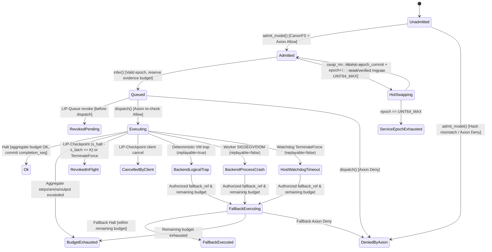

# RFC-00D7: T81 Model Service Boundary (`t81.model-service.v3-draft`)

- **RFC-ID:** RFC-00D7
- **Title:** T81 Model Service Boundary (`t81.model-service.v3-draft`)
- **Status:** draft
- **Type:** standards-track
- **Applies-To:** hosted AI runtime boundary, `Axion` capability governance, `CanonFS` trace/manifest verification, future `Axion OS` (`KAQR`) transport seam
- **Created:** 2026-11-15
- **Updated:** 2026-11-15
- **Discussion:** Independent Architecture Reconciliation (Phase 3 — R1 → R2 → R3 + Closure Addendum)

> [!CAUTION]
> **DRAFT / NON-NORMATIVE / NOT IMPLEMENTED**
>
> This document is an unratified draft specification prepared for independent review. It does **not** modify the frozen TISC ISA (`include/t81/isa/opcodes.hpp`, `spec/tisc-spec.md`), authorize ABI implementation, promote any experimental surface, or grant merge/release authority.

---

## 1. Existing Implemented Baseline vs. Proposed Service ABI

This RFC strictly separates **verified existing repository functionality** (`main` at `40695b0ba`) from **proposed unimplemented interfaces**:

| Surface | Status on `main` (`40695b0ba`) | Source Anchors |
|---|---|---|
| **T81VM single-opcode AI adapter** | **Implemented (bounded)** — runs synthetic `[<opcode>, Halt]` TISC programs; external `llama.cpp`/`onnxruntime` stubs deleted | `include/t81/vm/ai_backend/backend_adapter.hpp`, `vm/ai_backend/backend_adapter.cpp` |
| **Axion `TLoadHash` admission & AI hooks** | **Implemented (in-process gate)** — evaluates `SyscallContext` pre-dispatch and emits RFC-0032 §8.2 trace strings | `kernel/axion/ai_model_loader.cpp`, `kernel/axion/ai_hooks.cpp`, `vm/vm.cpp` |
| **CanonFS block-backed metadata auth** | **Implemented (tested)** — `publish_capability`, `revoke_capability`, `parity_repair_subtree` consult `axion_allow` | `fs/block_backed_driver.cpp` |
| **Model manifest schema (`RFC-00D3`)** | **Draft schema** — JSON schema exists for model manifests and diff/import results | `spec/rfcs/RFC-00D3-model-manifest-schema.json` |
| **Batch inference engine** | **Unbuilt / non-deterministic** — uses `std::mutex`, `std::condition_variable`, `<random>`; not compiled in `CMakeLists.txt` | `inference/batch_inference_engine.cpp` |
| **`t81.model-service.v3-draft` (`IModelService`, `IWorkerSupervisor`)** | **PROPOSED / NOT IMPLEMENTED** — defined solely by this draft RFC | This document (`RFC-00D7`) |
| **Axion OS `KAQR` / EL0 transport** | **Proposed / Future Phase B** — `ternaryos/` links `t81_core + t81_axion` (not `t81_vm`); `cpa004_evaluator` is off-`main` | `ternaryos/kernel/kernel_service_contract.hpp`, `ternaryos/ipc/canon_message.hpp` |

---

## 2. Logical Determinism vs. Physical Execution-Time Guarantees

This RFC strictly separates **logical determinism** (normative when no asynchronous host failure occurs) from **physical execution-time behavior** (non-normative, host-dependent):

1. **Independent Cross-Host Determinism (Zero Async External Events):** Given identical `(InferenceRequestV1, ModelRef, PolicyRef, epoch_id, seed)` and an admitted deterministic backend (`RFC-0042` equivalence) with **no** injected external revocations, client cancellations, or physical host timeouts, compliant hosts (`linux-x86_64`, `linux-arm64`, `macos-arm64`, `windows-x86_64`) **MUST** independently produce bit-identical `ServiceStatus`, `Trap`, `output_tensor_digest`, `consumed_budget`, and per-request `trace_canon_hash81`.
2. **Recorded-Event Replay (With External Events):** When an external `revoke`, `cancel`, or fault is injected at a recorded Logical Injection Point (`LIP`), cross-host bit-identity applies **only** to replaying that sealed `Epoch Commit Log`.
3. **Physical Execution-Time (Explicitly Unclaimed):** Wall-clock latency, OS scheduling jitter, and asynchronous physical failures (`HostWatchdogTimeout`, `BackendProcessCrash`) depend on the untrusted host OS hypervisor. **Universal cross-host bit-identity is explicitly prohibited for asynchronous host failures**, which **MUST** carry `replayable: false`.

---

## 3. Canonical Envelopes & Reconciled Outcome Taxonomy

### 3.1 Versioned Request & Response Envelopes (`t81.model-service.v1`)

All control envelopes exchange integer/string/digest fields only (no host pointers, raw `TensorHandle` integers, `<chrono>` timestamps, or floating-point values):

- **`InferenceRequestV1`:**
  - `schema_version`: `"t81.model-service.v1"`
  - `request_id`: caller-supplied `uint64_t` (encoded as canonical base-10 string in JCS traces)
  - `capability_token`: `{ capability_id, epoch_id, caller_id, min_tier: TierId }`
  - `model_ref`: `{ model_canon_hash81, manifest_canon_hash81 }`
  - `input_tensor_digest`: `CanonHash81` + canonical shape/dtype descriptor
  - `budget`: `InferenceBudgetV1` (`max_logical_steps`, `max_arena_bytes`, `max_output_bytes`, `evidence_reserve_steps`, `evidence_reserve_bytes`, supervisory `max_wall_ms`)
  - `seed`: `uint64_t` (`0` = deterministic greedy)
  - `fallback_ref`: optional pre-authorized `{ model_ref, policy_ref }`
- **`InferenceResponseV1`:**
  - `schema_version`: `"t81.model-service.v1"`
  - `request_id`, `dispatch_seq`, `completion_seq`
  - `status`: `ServiceStatus`
  - `vm_trap`: `Trap`
  - `error_origin`: `ErrorOrigin`
  - `replayable`: `bool`
  - `emergency_record_used`: `bool`
  - `output_tensor_digest`: optional `CanonHash81`
  - `consumed_budget`: `{ primary_steps, migration_steps, fallback_steps, evidence_steps, peak_arena_bytes, output_bytes, trace_bytes }`
  - `trace_canon_hash81`: `CanonHash81`

### 3.2 Unambiguous 1-to-1 Terminal Outcome Taxonomy

Every terminal state maps to **exactly one** `(ServiceStatus, Trap, ErrorOrigin, Replayable, FallbackAllowed)` tuple:

| `ServiceStatus` | `Trap` | `ErrorOrigin` | `Replayable` | Fallback Allowed? |
|---|---|---|---|---|
| `Ok` | `None` | `None` | `true` | N/A |
| `DeniedByAxion` | `SecurityFault` | `AxionGate` | `true` | **No** |
| `RevokedPending` | `SecurityFault` | `AxionGate` | `true` | **No** |
| `RevokedInFlight` | `SecurityFault` | `AxionGate` | `true` (`T81VM`) / `false` (native `SIGKILL`) | **No** |
| `CancelledByClient` | `None` | `Client` | `true` (at committed `LIP`) | **No** |
| `BudgetExhausted` | `TierFault` / `BoundsFault` | `LogicalVM` | `true` | **No** |
| `BackendLogicalTrap` | `DecodeFault` / `BoundsFault` / `TypeFault` | `LogicalVM` | `true` | **Yes** (depth $\le 1$) |
| `BackendProcessCrash` | `None` | `NativeBackendWorker` | `false` | **Yes** (depth $\le 1$) |
| `HostWatchdogTimeout` | `None` | `HostSupervisor` | `false` | **Yes** (depth $\le 1$) |
| `ServiceEpochExhausted` | `SecurityFault` | `HostSupervisor` | `true` | **No** |
| `FallbackExecuted` | `None` | `None` | `true` (iff primary failure was deterministic) | N/A (depth 1 reached) |

---

## 4. Normative Technical Specification (R3 Consolidated)

### 4.1 Immutable Model Identity & Authorization (`CanonFS` + `Axion`)
- `admit_model(ModelRef, Policy)` **MUST** verify `(model_canon_hash81, manifest_canon_hash81)` against `RFC-00D3` (`spec/rfcs/RFC-00D3-model-manifest-schema.json`), `BlockBackedDriver`, and `load_model_via_tloadhash` before allocating arenas or spawning workers.
- `Axion` evaluates `SyscallContext` both at `enqueue` and immediately before `dispatch` (eliminating TOCTOU between admission and execution).
- Fallback execution (`fallback_ref`) is permitted **only** on `BackendLogicalTrap`, `BackendProcessCrash`, or `HostWatchdogTimeout` (never on `DeniedByAxion`, `Revoked*`, or `BudgetExhausted`), requires independent `Axion` pre-authorization under the same `PolicySubject`, and has maximum depth **1**.

### 4.2 Event Ordering Without Head-of-Line (HoL) Blocking
- **Dispatch Serialization:** `admit_model`, `infer`, `cancel`, `revoke_*`, and `swap_model` commit to a serialized queue assigning monotonic `dispatch_seq` (with Rule O1 revocation precedence and Rule O2 `(priority, request_id)` dispatch order).
- **Non-Blocking Completion:** Each request commits its terminal state independently upon completion, receiving a monotonic `completion_seq` and returning `InferenceResponseV1` immediately without waiting behind slower or stalled `dispatch_seq` peers.
- **Host vs. Per-Request Identity:** `completion_seq` and cross-request `dispatch_seq` are host-scheduler metadata and **MUST** reside in `non_deterministic_host_telemetry` (or a separate session commit ledger), **excluded** from the per-request `integrity_digest_canon_hash81`. Within `t81.model-service-trace.v1`, `events[*].seq_no` **MUST** be a request-local, 1-based ordinal (`1, 2, ...`).

### 4.3 Authoritative Logical Injection Points (LIPs) & Measurable $K$-Step Bound
External `revoke_epoch`, `revoke_capability`, and `cancel(request_id)` calls are latched and injected **only** at deterministic Logical Injection Points:
1. **`LIP-Queue(dispatch_seq)`:** Evaluated prior to dispatch -> `RevokedPending` / `CancelledByClient` (`logical_step = 0`).
2. **`LIP-Checkpoint(logical_step, opcode_pc)`:** Polled inside `T81VM` every $K$ logical steps (default $K = 256$) and prior to every `TWMATMUL`, `TATTN`, `QMATMUL`, `ATTN`, `WLOAD`, and `TLoadHash`.
3. **`LIP-IPC(ipc_chunk_seq)`:** Polled at bounded native-worker IPC boundaries; if latched, further chunks are withheld and `TerminateForce` is issued.

- **Authoritative Commit Coordinate & Bound:** For `T81VM`, the authoritative revocation observation point is the first `LIP-Checkpoint` poll after `revoke_*` commits, atomically latching `s_latch = current_vm_logical_step`. Execution **MUST** halt at `s_halt` such that:
  $$0 \le s_{\text{halt}} - s_{\text{latch}} \le K$$
  Both `s_latch` and `s_halt` **MUST** be recorded in the `LIPInject` trace event: `CheckpointPoll -> RevocationObserved(s_latch) -> DiscardUncommittedOutputs -> ZeroArena -> SealTrace(s_halt) -> Return(RevokedInFlight)`.

### 4.4 Canonical Trace Serialization (`t81.model-service-trace.v1`), JCS Large Integers & Domain Separation
- **Canonical Encoding:** Serialized per RFC 8785 (JCS), **except** that all 64-bit integer fields (`uint64_t` / `int64_t`, including `request_id`, `epoch_id`, `seed`, `max_logical_steps`) **MUST** be encoded as canonical base-10 ASCII strings without leading zeros (preventing IEEE-754 `2^53 - 1` precision loss).
- **Domain Separation:** `CanonHash81` computation **MUST** prepend an explicit domain tag:
  - Normal trace: `"t81:ms:trace:v1:" || jcs_bytes`
  - Emergency record: `"t81:ms:emergency:v1:" || fixed_512b_slice`
- **Digest Inclusion / Exclusion Rules:**
  - **Excluded:** `integrity_digest_canon_hash81` itself and `non_deterministic_host_telemetry` (`completion_seq`, `dispatch_seq`, `host_wall_ms`, `worker_pid`, `os_signal`, `host_arch`).
  - **Included:** All normative fields (`trace_schema`, `request_id`, `epoch_id`, `model_canon_hash81`, `manifest_canon_hash81`, `backend_id`, `policy_canon_hash81`, `replayable`, `events` with `LIP` coordinates, `logical_counters`, `terminal`, and `extensions`).
- **Schema Evolution & Verification:** Unknown top-level keys fail closed. Verifiers parse JCS bytes, validate `trace_schema == "t81.model-service-trace.v1"`, verify strictly increasing request-local `events[*].seq_no` and non-decreasing `logical_step`, strip excluded telemetry, and assert exact `CanonHash81` equality.

### 4.5 Two-Level Aggregate Memory, Budgets & Emergency Failure-Record Slab
- **Logical Step & Output Budget:** One non-replenishable `InferenceBudgetV1` bounds primary + migration + fallback + reserved evidence steps and output + trace bytes.
- **Two-Level Memory Budget:**
  1. Per-request: $\max(\text{arena}_{\text{primary}}, \text{arena}_{\text{migration}}, \text{arena}_{\text{fallback}}) \le \text{max\_arena\_bytes}$.
  2. Service-wide (`service_max_bytes`):
     $$\text{mem}_{\text{active\_models}} + \text{mem}_{\text{swap\_staging}} + \text{mem}_{\text{migration}} + \sum_{i \in \text{Executing}} \text{arena}_i + \text{mem}_{\text{emergency\_reserve}} \le \text{service\_max\_bytes}$$
- **Bounded Emergency Failure-Record Slab:** At startup, the service pre-allocates `mem_emergency_reserve` as a fixed-size, zero-heap-allocation array of $512$-byte emergency records (`t81.emergency-fail.v1`). This guarantees non-crashing `InferenceResponseV1` construction under OOM/output exhaustion, **not** crash durability across power loss. Where a pre-opened, pre-allocated fixed-size emergency journal file on `CanonFS` is configured, the supervisor **MUST** write and `fsync` the 512-byte slot best-effort and record `durable_persisted: true | false` inside the emergency record.

### 4.6 Atomic Hot-Swap, Stale Handles & Durable Revocation
- **Atomic Publication:** `swap_model(M_old -> M_new)` verifies `service_max_bytes` headroom (or drains `M_old` first), validates `state_schema_hash81` + `Axion` `migrate_state` (default: explicit state reset), and atomically flips `(active_model, active_epoch = k + 1)`.
- **Epoch Overflow:** `epoch_id == UINT64_MAX` fails closed (`ServiceEpochExhausted`); wraparound is forbidden.
- **Stale Handles:** Caller tokens bind `(epoch_id, generation)`; raw VM `TensorHandle` IDs never cross the service boundary.
- **Durable Revocation:** `revoke_epoch` / `revoke_capability` **MUST** persist `revoked_watermark_epoch` to `CanonFS` with `fsync` before returning `ok` (reloaded on restart).

### 4.7 Two-Tier Fault Isolation & Cross-Platform Worker Supervision (`IWorkerSupervisor`)
`IWorkerSupervisor` exposes `{ Spawn, PollIPC, CancelGraceful, TerminateForce, Reap }` without OS-specific types in the service core. Process creation and `TerminateForce` do **not** alone constitute security containment; production qualification requires platform OS sandbox gates:

| Platform | Containment & Memory Gate (Production Qualification) | Death Monitoring | `TerminateForce` |
|---|---|---|---|
| **Linux** | Non-root UID/GID, `PR_SET_NO_NEW_PRIVS`, `PR_SET_PDEATHSIG(SIGKILL)`, `seccomp-bpf` allowlist, `cgroup v2`/`RLIMIT_AS` | `pidfd` / `waitpid(..., WNOHANG)` | `kill(-pid, SIGKILL)` + reap |
| **macOS** | Unprivileged execution + Seatbelt/sandbox profile denying network & arbitrary FS writes outside pinned `CanonFS` read-only FDs, `setrlimit` | `kqueue` `EVFILT_PROC` (`NOTE_EXIT`) | `SIGKILL` + reap |
| **Windows** | `AppContainer` or Restricted Token, `Job Object` (`KILL_ON_JOB_CLOSE`, `JOB_OBJECT_LIMIT_PROCESS_MEMORY`, `ACTIVE_PROCESS=1`), `PROC_THREAD_ATTRIBUTE_HANDLE_LIST` | `WaitForSingleObject` / IOCP | `TerminateJobObject` + close |

- **Hosted First, Axion OS Seam:** Hosted `t81_vm + t81_axion + t81_core` ships first; future `Axion OS` serializes `InferenceRequestV1`/`ResponseV1` over `KAQR` (`ternaryos/kernel/kernel_service_contract.hpp`, `ternaryos/ipc/canon_message.hpp`) with EL0 `TTBR0_EL1` isolation.

---

## 5. R3 Contract Closure Addendum (Integrated Summary)

1. **`completion_seq` Exclusion (§4.2):** Moved `completion_seq` and cross-request `dispatch_seq` to `non_deterministic_host_telemetry`; per-request `events[*].seq_no` is 1-based local.
2. **Emergency Record Durability (§4.5):** Distinguished zero-alloc in-memory OOM safety from best-effort pre-opened journal `fsync` via explicit `durable_persisted: bool`.
3. **JCS 64-Bit Strings & Domain Tags (§4.4):** Mandated canonical decimal-string encoding for 64-bit integers, domain-separated `CanonHash81` prefixes, and `extensions` hash coverage.
4. **Authoritative `(s_latch, s_halt)` Bound (§4.3):** Defined measurable bound $0 \le s_{\text{halt}} - s_{\text{latch}} \le K$ at `LIP-Checkpoint`.
5. **OS Containment Gates (§4.7):** Defined explicit Linux (`seccomp-bpf`/`cgroup v2`), macOS (Seatbelt/`kqueue`), and Windows (`AppContainer`/`Job Object`) qualification requirements.

---

## 6. R1-to-R3 Change History

| Revision | Key Changes |
|---|---|
| **R1 (Initial)** | Defined 10 core properties (`CanonFS` identity, versioned envelopes, budgets, Axion dual-check, pending/in-flight revocation, trace/replay, hot-swap, fault isolation, depth-1 fallback, hosted-first + `KAQR` seam), `TM-01`–`TM-07`, `AT-MS-01`–`AT-MS-10`. |
| **R2 (Revision 2)** | Separated `ReplayableLogical` vs. `NonReplayablePhysicalAbort`; prohibited cross-host bit-identity claims for async timeouts; separated process vs. VM isolation; added `t81.model-service-trace.v1`, $K$-step checkpoints, aggregate primary+fallback+migration+evidence budgets, `fsync` durable revocation, 1-to-1 outcome taxonomy, `TM-08`–`TM-10`, `AT-MS-11`–`AT-MS-15`. |
| **R3 (Final Baseline)** | Split recorded-event replay vs. independent cross-host determinism; decoupled `completion_seq` from `dispatch_seq` (no HoL blocking); specified `LIP` injection points; added JCS rules + digest exclusions; added `service_max_bytes` + 512B emergency slab; defined cross-OS `IWorkerSupervisor`; added `TM-11`–`TM-13`, `AT-MS-16`–`AT-MS-20`. |
| **R3 Closure Addendum** | Excluded `completion_seq` from per-request trace digest; added `durable_persisted` flag; mandated base-10 string 64-bit JCS + domain tags + `extensions` integrity; pinned `(s_latch, s_halt)` $K$-step bound; added OS sandbox qualification gates and `AT-MS-21`–`AT-MS-25`. |

---

## 7. Threat Model (`TM-01`–`TM-13`)

| ID | Threat Vector | Mitigation |
|---|---|---|
| **TM-01** | Unverified / tampered weights | `CanonHash81` verification of `RFC-00D3` manifest + weights via `CanonFS` + `load_model_via_tloadhash` (§4.1). |
| **TM-02** | TOCTOU / revocation bypass | Dual `Axion` check (`enqueue` + `dispatch`) + `LIP-Checkpoint` barrier + worker `TerminateForce` (§4.1, §4.3). |
| **TM-03** | Fallback policy laundering | Fallback forbidden on `DeniedByAxion`/`Revoked*`/`BudgetExhausted`; independent `Axion` gate (§4.1). |
| **TM-04** | Stale / cross-tenant tensor handles | Boundary exchanges `CanonHash81` digests only; per-request arenas wiped on exit/swap (§3.1, §4.6). |
| **TM-05** | Loop / OOM DoS | `max_logical_steps` + `max_arena_bytes` + external watchdog `TerminateForce` + circuit breaker (§4.5, §4.7). |
| **TM-06** | Epoch wraparound replay | Strict `UINT64_MAX` fail-closed `ServiceEpochExhausted` freeze (§4.6). |
| **TM-07** | Nondeterminism injection | Zero `<chrono>`/`<random>` in deterministic paths; explicit `seed`; `(priority, request_id)` dispatch (§2, §4.2). |
| **TM-08** | `dispatch`/`revoke`/`cancel` race | Total `dispatch_seq` serialization + Rule O1 + $\le K$ checkpoint barrier (§4.2, §4.3). |
| **TM-09** | Restart revocation erasure | `fsync`-sealed `revoked_watermark_epoch` in `CanonFS` reloaded on startup (§4.6). |
| **TM-10** | Aggregate budget laundering | Single non-replenishable `InferenceBudgetV1` with pre-reserved evidence allocation (§4.5). |
| **TM-11** | Head-of-line starvation | Independent `completion_seq` commit + per-worker `max_wall_ms` `TerminateForce` (§4.2, §4.7). |
| **TM-12** | Telemetry / extension tampering | `non_deterministic_host_telemetry` excluded from digest; `extensions` and domain tags included; unknown keys fail closed (§4.4). |
| **TM-13** | Swap-induced OOM / trace loss | `service_max_bytes` hot-swap gate + zero-heap 512B emergency slab (`durable_persisted` flag) (§4.5). |

---

## 8. State-Machine Diagram

---

## 9. Complete Acceptance-Test Matrix (`AT-MS-01`–`AT-MS-25`)

| Test ID | Target Property | Stimulus | Expected Normative Outcome |
|---|---|---|---|
| **AT-MS-01** | Immutable manifest admission | Altered 1-byte weight or mismatched `RFC-00D3` manifest hash | `admit_model` returns `false`; `CanonFS` mismatch logged; zero worker spawn. |
| **AT-MS-02** | Cross-host determinism | Identical `InferenceRequestV1` (`seed=42`, no async events) on Linux/macOS/Windows | Bit-identical `output_tensor_digest`, `consumed_budget`, `trace_canon_hash81`. |
| **AT-MS-03** | Step & arena caps | `max_logical_steps=10` on 100-step task; tight `max_arena_bytes` | Fails closed with `BudgetExhausted`; partial arena zeroed; trace sealed. |
| **AT-MS-04** | Pending revocation | Enqueue 3 requests at `epoch=5`; `revoke_epoch(5)` before dispatch | All 3 return `RevokedPending` (`LIP-Queue`); backend never invoked. |
| **AT-MS-05** | In-flight revocation | Long-running task at `epoch=5`; `revoke_epoch(5)` mid-execution | Halts at checkpoint or `TerminateForce`; returns `RevokedInFlight` + `SecurityFault`. |
| **AT-MS-06** | Hot-swap reset vs. migrate | `swap_model` with (a) incompatible schema, (b) compatible `state_schema_hash81` + `Allow` | (a) State reset cleanly; (b) Deterministic migration verified; `epoch` -> `k+1`. |
| **AT-MS-07** | Backend crash & hang | Inject `SIGSEGV` and `while(1)` in isolated backend worker | Supervisor stays alive; watchdog reaps worker; `BackendProcessCrash` / `HostWatchdogTimeout`. |
| **AT-MS-08** | Authorized fallback | (a) `BackendProcessCrash` with authorized fallback; (b) `DeniedByAxion` with fallback | (a) `FallbackExecuted` (depth 1); (b) **No fallback**, returns `DeniedByAxion`. |
| **AT-MS-09** | Epoch overflow & stale handle | Swap at `UINT64_MAX`; pass `epoch=1` token/raw handle into `epoch=2` | Swap -> `ServiceEpochExhausted`; stale token/raw handle rejected fail-closed. |
| **AT-MS-10** | Axion OS `KAQR` parity | Serialize `InferenceRequestV1`/`ResponseV1` over `KAQR` (`canon_message.hpp`) | Round-trip byte/digest identity with hosted envelope. |
| **AT-MS-11** | Async non-replayability | Trigger `HostWatchdogTimeout` on two hosts | Traces marked `replayable: false`, `error_origin: HostSupervisor`; no cross-host bit-identity claimed. |
| **AT-MS-12** | Concurrency race | 1,000 concurrent `infer`, `cancel`, `revoke_epoch` calls | `dispatch_seq` obeys Rule O1; zero post-revocation dispatches; replay matches verdict order. |
| **AT-MS-13** | Checkpoint interval $K$ | $K=256$; inject `revoke_epoch` at step $100$ of $10{,}000$-step VM task | Halts within $\le 256$ steps; emits `RevokedInFlight` / `SecurityFault` / `AxionGate`. |
| **AT-MS-14** | Aggregate budget | `max_logical_steps=500`, `evidence_reserve=50`; primary fails at 420 -> fallback needs 100 | Fallback stops at `BudgetExhausted` (step 450); 50-step reserve seals trace within 500. |
| **AT-MS-15** | Durable revocation | `revoke_epoch(7)`, kill/restart supervisor, submit `epoch=7` request | Reloads sealed `revoked_watermark_epoch=7` from `CanonFS`; returns `RevokedPending`. |
| **AT-MS-16** | HoL unblocking | Dispatch slow `req_1` (`while(1)`, `max_wall_ms=200`) then fast `req_2` (`Ok`) | `req_2` commits `completion_seq` and returns `Ok` without waiting on `req_1`. |
| **AT-MS-17** | `LIP` recording & replay | Inject async `revoke_epoch`; replay captured log 100x with host jitter | All 100 replays halt at identical recorded `(LIP-Checkpoint, logical_step)` and `trace_canon_hash81`. |
| **AT-MS-18** | Digest exclusion & tamper | (a) Mutate `host_wall_ms` in telemetry; (b) Mutate `logical_step` or add unknown top-level key | (a) Digest verifies; (b) Verifier fails closed. |
| **AT-MS-19** | Service-wide OOM & slab | Fill `service_max_bytes` to 95%; trigger `swap_model` + `BackendProcessCrash` | `swap_model` defers/drains `M_old`; crashed request seals 512B emergency record (`emergency_record_used=true`). |
| **AT-MS-20** | Cross-OS worker reap | Hostile worker spawning child + `while(1)` on Linux, macOS, Windows | `TerminateForce` (`SIGKILL` / `TerminateJobObject`) reaps all descendants cleanly. |
| **AT-MS-21** | Divergent `completion_seq` | Run `req_A` concurrently with `req_B` so `completion_seq` differs across 2 hosts | `req_A.trace_canon_hash81` is bit-identical across both hosts. |
| **AT-MS-22** | Emergency durability flag | (a) `ENOMEM` + `ENOSPC`; (b) `ENOMEM` with pre-opened `CanonFS` emergency journal | (a) Valid 512B slab with `durable_persisted=false`; (b) Persists across `SIGKILL` (`durable_persisted=true`). |
| **AT-MS-23** | JCS 64-bit & domain tags | `seed = UINT64_MAX - 1`; 1-byte `extensions` tamper; cross-domain emergency/trace swap | Exact 64-bit string round-trip; tamper and domain confusion fail closed. |
| **AT-MS-24** | Measurable `(s_latch, s_halt)` | $K=256$; 50 randomized `revoke_epoch` injections | Every trace satisfies $0 \le s_{\text{halt}} - s_{\text{latch}} \le 256$ with zero post-halt AI side effects. |
| **AT-MS-25** | OS containment gates | Hostile native worker attempts `fork()`, TCP `connect()`, `/etc/passwd` write | Denied by Linux `seccomp`/cgroup, macOS Seatbelt, Windows `AppContainer`/Job Object. |

---

## 10. Unresolved-Issues Register & Implementation Prerequisites

| Item | Classification | Rationale / Prerequisite |
|---|---|---|
| Concrete native-worker IPC framing (sealed read-only `mmap` vs. chunked pipe wire format) | **BLOCKS IMPLEMENTATION** | `IWorkerSupervisor` IPC cannot be coded without a pinned wire/SHM layout. |
| `spec/tisc-spec.md` vs. `vm/vm.cpp` normative reconciliation (`Load`, `Store`, `Jump*`, `TXor`) | **BLOCKS IMPLEMENTATION** | Hosted `T81VM` service execution relies on unambiguous ISA semantics. |
| `Axion OS` (`KAQR` / `canon_message.hpp`) fixed-buffer byte-budget mapping | **BLOCKS IMPLEMENTATION** *(Phase B OS transport only; does not block Phase A hosted)* | Requires `cpa004_evaluator` on `main` and `KAQR` frame sizing verification. |
| Platform-specific sandbox allowlists (`seccomp-bpf`, Seatbelt, `AppContainer`) | **BLOCKS PRODUCTION QUALIFICATION** | Hosted PoC may validate process isolation first; production claims require OS sandbox qualification. |
| External monotonic rollback anchor for `revoked_watermark_epoch` (beyond single-host `fsync`) | **BLOCKS PRODUCTION QUALIFICATION** | Single-host disk snapshots can still roll back local `CanonFS` watermarks. |
